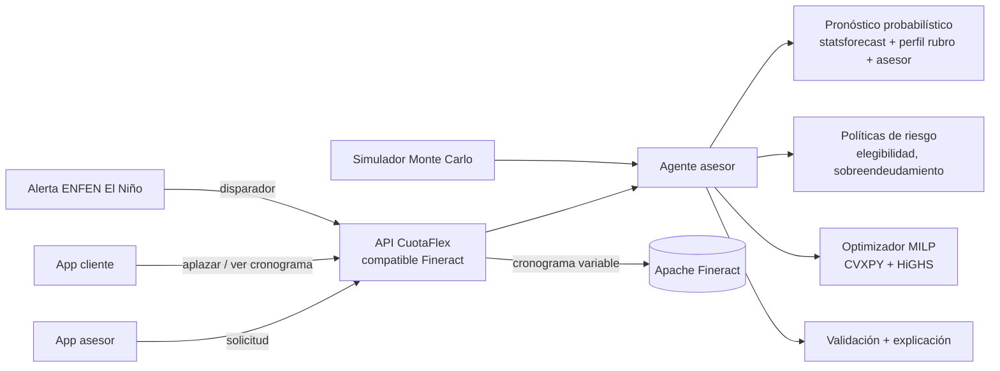

# Arquitectura

## Flujo de una solicitud

1. `POST /clients` y `POST /loans`. El agente genera la propuesta y el préstamo queda *pendiente de aprobación*.
2. `GET /loans/{id}?associations=repaymentSchedule` devuelve el cronograma con capital, interés y saldo.
3. `POST /loans/{id}/schedule?command=addVariations` permite al asesor ajustar cuotas antes de aprobar. La última cuota la recalcula el sistema.
4. `POST /loans/{id}?command=approve` y luego `?command=disburse`.
5. `POST /loans/{id}/transactions?command=repayment` registra pagos.
6. `POST /loans/{id}/flex?command=deferInstallment` aplica un aplazamiento validado: cuota mínima y el diferido redistribuido con interés.

## Optimizador

Variables: cuota `c_t`, déficit `s_t ≥ 0` y una binaria `z_t` que marca la cuota reducida.

- Restricciones: `Σ c_t/(1+i)^t = P`, `piso ≤ c_t ≤ techo`, `c_t − s_t ≤ 0.7·excedente_p25,t`,
  `c_t ≥ u − (u − piso)·z_t`, `Σ z_t ≤ 4·años`.
- Objetivo: `min 100·Σ s_t/ref + 0.02·Σ |c_t − ref|/ref`.

## Paso a Fineract real

Habilitar *variable installments* en el producto de crédito y apuntar el cliente HTTP a
`/fineract-provider/api/v1` con el encabezado `Fineract-Platform-TenantId`. Antes hay que
comprobar en el Swagger de la versión instalada los cuerpos exactos de `addVariations`.
