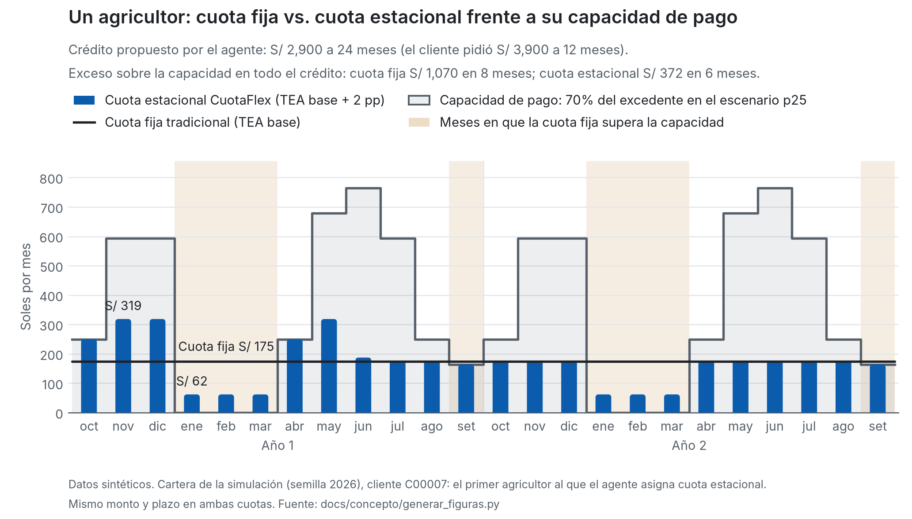
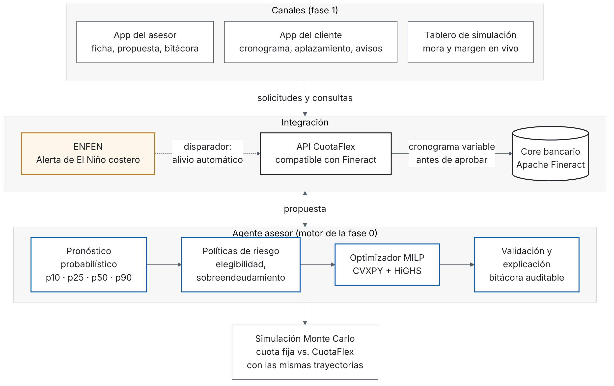
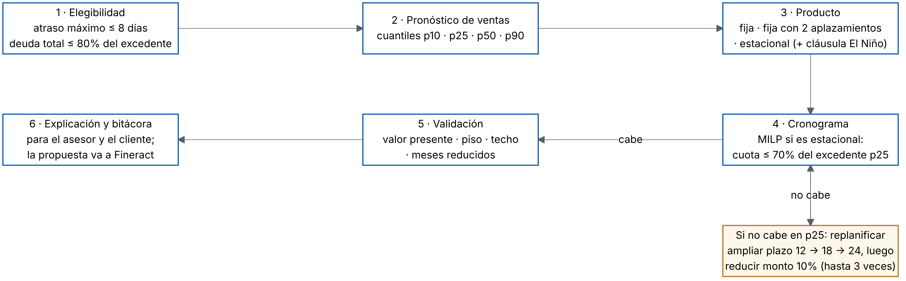

# CuotaFlex · Solution Concept

**Cajathón 2026 · Caja Trujillo · Eje 4: Inclusión financiera y resiliencia · Desafío NEG-01 "Cuotas que se adaptan al flujo del negocio"**

Equipo Sabado de paz (CJT-WG3TXH) · Versión del 23/11/2026 · Todos los resultados son de una simulación con datos sintéticos.

## Resumen ejecutivo

Los ingresos de los microempresarios de La Libertad suben y bajan con las campañas agrícolas, la pesca, las fechas comerciales y la producción de calzado, pero la cuota fija exige lo mismo todos los meses. CuotaFlex es un agente para el asesor de negocios: pronostica las ventas del cliente con incertidumbre, elige entre cuota fija, cuota con aplazamientos o cuota estacional, y optimiza el cronograma para que cada cuota quepa en el escenario conservador sin que la Caja pierda valor presente. Si el ENFEN declara alerta de El Niño costero, se activa un alivio pactado. En una simulación con 600 créditos sintéticos y 200 escenarios por crédito, el atraso mayor a 30 días bajó de 16.3% a 7.3% y el margen neto sobre la cartera subió de 16.5% a 22.7%, con 14% menos colocación. El motor, la API compatible con Fineract y las pruebas ya funcionan.

## 1. Problema abordado

> ¿Cómo podríamos ofrecer alternativas de pago que se ajusten a las variaciones de ingresos de los microempresarios, sin comprometer su capacidad de pago ni la sostenibilidad financiera de Caja Trujillo?
> — Pregunta de innovación del desafío NEG-01

- **Ingresos por temporadas.** En La Libertad la agricultura cobra en la cosecha, la pesca alterna temporadas de captura con vedas, el comercio depende de la campaña escolar, el Día de la Madre, Fiestas Patrias y Navidad, y el calzado produce para las campañas escolar y de fin de año. En temporada baja el excedente del negocio puede llegar a cero.
- **La cuota fija cae justo en el mes de menos caja.** Un negocio viable en el año puede atrasarse por falta de liquidez en unos pocos meses, no por falta de capacidad. El sobrante de la temporada alta no se guarda completo: se reinvierte o se gasta.
- **Un riesgo climático que llega a todos a la vez.** El Niño costero golpea al mismo tiempo a rubros enteros de la región. El ENFEN mantiene la alerta: el evento empezó en marzo de 2026 y se espera que tenga magnitud extraordinaria hasta febrero de 2027 [1].

## 2. Concepto de solución

CuotaFlex es un **agente de decisión para el asesor de negocios**. Con la solicitud y el historial del cliente, propone producto, monto, plazo y cronograma, y explica por qué. El asesor revisa y decide, y el cronograma se registra en el core antes de la aprobación. El cliente ve sus cuotas en su app, puede pedir un aplazamiento si está al día y recibe el alivio automático si el ENFEN declara alerta.

### 2.1 Modalidades y reglas

| Modalidad | Para quién | Regla principal |
|---|---|---|
| Cuota fija | Clientes con atrasos de más de 8 días o con deudas que superan el 80% del excedente | Cronograma tradicional |
| Fija con aplazamientos | Buen historial y negocio poco estacional (bodega, servicios) | Hasta 2 cuotas por crédito al mínimo (35% de la cuota), solo si está al día; lo diferido se reparte con interés en las cuotas siguientes |
| Estacional | Buen historial y negocio estacional (agricultura, pesca, comercio de campaña, calzado) | Cuotas optimizadas según el flujo, entre 35% y 180% de la cuota fija, con hasta 4 meses reducidos por año |
| Cláusula El Niño | Rubros expuestos: agricultura, pesca y comercio de campaña | Si el ENFEN declara alerta, hasta 3 cuotas pasan al mínimo de forma automática |

Las opciones flexibles llevan un recargo referencial de +2 pp en la TEA, para que las elijan quienes de verdad las valoran (autoselección), y se pierden con 30 días de atraso. Todas las reglas están en `config/parametros.yaml` y el área de Riesgos puede calibrarlas.

### 2.2 Evidencia que respalda el diseño

| Experiencia | Resultado | Qué toma CuotaFlex |
|---|---|---|
| **BRAC, Bangladesh** [2]: aplazar hasta 2 cuotas por ciclo, solo con buen historial | En los créditos pequeños, ganancia mensual 27% mayor y default 35% menor que el 4.8% del grupo de comparación | Hasta 2 aplazamientos y requisito de historial |
| **Kolkata, India** [3]: 2 meses de gracia sin condiciones | Más inversión y más negocios nuevos, pero el impago a 24 semanas del vencimiento pasó de 2% a 9% | Cuota mínima obligatoria y flexibilidad solo con buen pago |
| **Sonata, India** [4]: opción flexible con +2 pp de tasa y una pausa de 3 meses | Casi 1 de cada 3 la eligió; cerca del 90% pagó a tiempo en ambos grupos y las ventas fueron entre 16% y 22% mayores | Recargo de +2 pp para la autoselección |
| **Bangladesh rural** [5]: cuotas ajustadas a la temporada baja (2011-2012) | Sin diferencias significativas en impago ni en montos vencidos (resultados preliminares) | Cuota estacional con piso y techo |
| **Shopify Capital** [6]: cobra un porcentaje fijo de las ventas diarias | Se paga más cuando se vende más y menos cuando las ventas caen | Referencia de largo plazo cuando haya ventas registradas; los primeros intercambios de Finanzas Abiertas están previstos para 2028 [7] |
| **Caja Nuestra Gente, norte del Perú** [8]: seguro paramétrico contra El Niño extremo | Protegió 585 créditos agrícolas por USD 4.6 millones | Disparador objetivo para la cláusula El Niño |

### 2.3 Gestión de riesgos y cumplimiento

- **Capacidad de pago:** cada cuota se diseña contra el escenario conservador p25 de ventas, no contra el promedio, para no superar el 70% del excedente de ese escenario. Si no cabe, el agente replanifica.
- **Sobreendeudamiento:** si la cuota nueva más las otras deudas supera el 80% del excedente, no hay flexibilidad y el agente reduce el monto. Nunca sube el monto para que un cronograma quepa.
- **Selección prudente:** la flexibilidad exige buen historial porque, con clientes nuevos, los "pases" de pago elevaron el default en Colombia [9].
- **Rentabilidad:** el valor presente de las cuotas, descontado a la tasa del crédito, es igual al capital. La flexibilidad cambia cuándo se paga, no cuánto vale el crédito.
- **Transparencia:** el cliente recibe el cronograma completo y la TCEA antes de firmar; el aplazamiento y la cláusula El Niño quedan pactados en el contrato.
- **Por validar con la Caja y la SBS:** la conformidad con las normas de transparencia, el tratamiento contable de los aplazamientos pactados y en qué se diferencian de una reprogramación. También, si la Caja ya ofrece cuotas estacionales o pago a cosecha.

## 3. Impacto esperado

El resultado esperado del reto es mejorar la capacidad de cumplimiento de los clientes sin comprometer la rentabilidad de la Caja. Por eso medimos el atraso y el default (cumplimiento) y el margen neto (rentabilidad). Los resultados son de una simulación con datos sintéticos: 600 créditos y 200 escenarios de ingresos y de El Niño por crédito, con las mismas trayectorias para las dos estrategias (`resultados/resumen.json`, semilla 2026).

| Indicador | Cuota fija | CuotaFlex completo | Solo cronograma |
|---|---|---|---|
| Créditos con atraso > 30 días | 16.3% | **7.3%** (−55%) | 14.3% (−12%) |
| Default (3 cuotas impagas seguidas) | 8.5% | **3.4%** (−60%) | 7.7% (−10%) |
| Margen neto / cartera | 16.5% | **22.7%** | 17.1% |
| Margen neto total (valor presente) | S/ 742 mil | **S/ 883 mil** (+S/ 140 mil) | S/ 772 mil (+S/ 29 mil) |
| Cartera colocada | S/ 4.51 M | S/ 3.89 M (−14%) | S/ 4.51 M |

*Completo* incluye el dimensionamiento del monto y del plazo. *Solo cronograma* mantiene el monto y el plazo solicitados para aislar el efecto de las cuotas flexibles.

**Cómo leer estas cifras**

- **La mayor parte del efecto viene de dimensionar bien el monto y el plazo.** Solo con el cronograma el atraso baja 1.9 puntos; con el dimensionamiento, baja 9.0.
- **La cartera colocada baja 14%** porque el agente no sobreendeuda. El margen neto total sube igual (+S/ 140 mil), pero ese intercambio hay que decidirlo con la Caja.
- **El supuesto clave es cuánto del sobrante mensual se gasta** (`fuga_caja_mensual` = 15%). Si el cliente ahorrara todo el sobrante de la temporada alta, la cuota estacional no aportaría. Hay que medirlo con datos de la Caja.
- **El beneficio se concentra en los rubros más estacionales.** El atraso baja de 44.3% a 20.1% en agricultura y de 46.4% a 22.6% en pesca. En calzado y comercio de campaña, el cronograma por sí solo empeora un poco (de 8.0% a 9.9% y de 6.8% a 8.2%), y el umbral de estacionalidad está en calibración.
- Los datos son sintéticos y la cartera está estresada a propósito: las cifras muestran el método, no son una promesa de resultados.

*Figura 1. Un agricultor de la cartera simulada. Con el mismo monto y plazo, la cuota fija supera su capacidad en 8 meses (S/ 1,070 en total) y la estacional en 6 (S/ 372), los meses en que no tiene excedente. Fuente: `docs/concepto/generar_figuras.py`.*

## 4. Enfoque tecnológico

CuotaFlex no es un chatbot ni un tablero: **decide** el producto y el tamaño del crédito, **optimiza** el cronograma con restricciones de riesgo y **demuestra** su efecto con una simulación causal.

1. **Pronóstico probabilístico.** Combina el historial del cliente (statsforecast, AutoETS estacional), el perfil estacional de negocios similares y un ajuste del asesor limitado a ±10%. Entrega los cuantiles p10, p25, p50 y p90, no un número único.
2. **Optimización entera mixta (MILP).** Con CVXPY y HiGHS decide cada cuota. El valor presente cierra el crédito, hay piso y techo (sin cuotas globo) y un límite de meses reducidos. El objetivo prioriza que cada cuota quepa en el 70% del excedente p25 y, después, que se parezca a la cuota fija.
3. **Agente que replanifica y explica.** Ejecuta elegibilidad, pronóstico, producto, cronograma y validación. Si la propuesta no cabe, amplía el plazo y después reduce el monto. Deja una bitácora auditable y explica la decisión en lenguaje simple. Un LLM es opcional y no inventa cifras.
4. **Simulación Monte Carlo causal.** Genera trayectorias de ventas con estacionalidad, choques y El Niño, y aplica la cuota fija y CuotaFlex sobre las mismas trayectorias: la diferencia mide el efecto del producto.
5. **Integración con el core.** Una API que imita los recursos de Apache Fineract: clientes, préstamos con cuotas variables, aprobación, desembolso, pagos y aplazamiento. El cronograma se carga antes de aprobar, como pide la función de cuotas variables de Fineract [10].

*Figura 2. Arquitectura e integración. Fuente: `docs/concepto/img/arquitectura.mmd`.*

*Figura 3. Flujo del agente; se lee en forma de S. Fuente: `docs/concepto/img/flujo-agente.mmd`.*

## 5. Tecnología preexistente

El equipo construyó esta base antes de la fase presencial, durante la etapa Discover & Design:

- **Fase 0 (22/11/2026):** el motor (pronóstico, políticas, optimizador y agente), la API compatible con Fineract, la simulación Monte Carlo, la cartera sintética y las pruebas automatizadas.
- **Fase 1 (22 al 24/11/2026, en curso):** la app web del asesor, la app del cliente, el tablero de simulación y este documento.

Si el equipo gana, cede a la Caja los derechos económicos sobre lo desarrollado específicamente durante el Cajathón, y lo preexistente queda con sus titulares (bases, 8.3) [11]. Como las fases 0 y 1 se hicieron durante la etapa virtual, consultamos a la organización si cuentan como tecnología preexistente.

| Componente de terceros | Uso | Licencia |
|---|---|---|
| NumPy, pandas, SciPy | Cálculo y datos | BSD-3-Clause |
| PyYAML | Parámetros | MIT |
| CVXPY | Modelado del MILP | Apache-2.0 |
| HiGHS (highspy) | Solver del MILP | MIT |
| statsforecast | Pronóstico (AutoETS) | Apache-2.0 |
| FastAPI · Uvicorn · HTTPX | API y pruebas de la API | MIT · BSD-3-Clause · BSD-3-Clause |
| pytest | Pruebas automatizadas | MIT |
| Matplotlib | Figuras del concepto | Matplotlib License (tipo PSF) |
| React · React Router · Recharts · Vite | Apps web y tablero | MIT |
| TypeScript | Apps web | Apache-2.0 |
| Lucide | Íconos de la app del cliente | ISC |
| Apache Fineract (opcional, fase presencial) | Core bancario | Apache-2.0 |

Son opcionales y no se usan en el prototipo actual: Chronos, el SDK de Anthropic y SDV. Antes de usar cualquiera se revisa su licencia; SDV, por ejemplo, usa la Business Source License 1.1, que no es de código abierto.

## 6. Funcionalidad crítica

En la fase presencial construiremos **la adaptación de CuotaFlex a Caja Trujillo**, que solo es posible con la información y los accesos que la Caja habilite en el evento (bases, 7.2) [11]:

1. **Calibración con datos de la Caja:** perfiles estacionales por rubro y región, umbral de estacionalidad, tasas, plazos y ratios de capacidad de pago y de sobreendeudamiento, con backtesting sobre el historial anonimizado.
2. **Integración del cronograma variable con el core:** registro de la propuesta antes de la aprobación, en Fineract o en el entorno de prueba de la Caja, y aplazamiento validado desde la app del cliente.
3. **Disparador del ENFEN de punta a punta:** lectura del estado de alerta, activación del alivio en los créditos expuestos y aviso al cliente.

**Caso de uso de la demo:** un agricultor de Virú pide un crédito en temporada baja. El asesor recibe la propuesta calibrada, la explica y la registra en el core, y el cliente ve su cronograma. Luego se simula una alerta del ENFEN y el alivio se aplica solo.

## 7. Nivel de desarrollo esperado

Al cierre de la hackathon esperamos un prototipo funcional, no productivo, que ejecute el caso de uso de punta a punta con parámetros calibrados con información de la Caja. Incluye la propuesta del agente en la app del asesor, el cronograma registrado en el core, el aplazamiento y el alivio El Niño en la app del cliente, y el tablero con la mora y el margen a la escala de la Caja. Tendrá pruebas automatizadas y no usará datos personales reales. Quedan fuera la puesta en producción, la seguridad institucional y la validación regulatoria.

## 8. Factibilidad y dependencias

### 8.1 Lo que ya funciona

- El motor, la API y la simulación corren y tienen pruebas automatizadas (`pytest`). La simulación se reproduce con `python scripts/simular.py`.
- Las tres apps de la fase 1 avanzan en paralelo, cada una en su rama, sobre la misma API.
- Repositorio del equipo: github.com/Defartion/Hackathon-Caja-Trujillo (privado).

### 8.2 Datos e insumos que se solicitan a la Caja

| Insumo del reto | Qué pedimos | Para qué | Si no está disponible |
|---|---|---|---|
| Flujos de ingresos | Ventas o flujos de la evaluación del asesor, por rubro y región | Calibrar el pronóstico y el excedente | Perfil sintético por rubro |
| Estacionalidad del negocio | Calendario por rubro validado por asesores de campo | Perfiles y umbral de estacionalidad | Perfiles referenciales actuales |
| Historial de pagos | Días de atraso por cuota y reprogramaciones, anonimizados, incluidos El Niño 2017 y 2023 | Backtesting de la mora | Cartera sintética estresada |
| Condiciones crediticias | Montos, productos y requisitos vigentes | Reglas de elegibilidad y de producto | Reglas de `parametros.yaml` |
| Tasas y plazos | TEA por segmento, plazos, costo de fondeo y gasto operativo | Rentabilidad y valor presente | TEA 45%, fondeo 8%, gasto operativo 6% |
| Políticas de riesgo | Capacidad de pago, sobreendeudamiento y recuperación | Restricciones del optimizador | Ratios actuales de 70% y 80% |
| Datos sintéticos | Base sintética de la Caja, si existe | Demo a la escala de la Caja | Generador propio (`cuotaflex.datos`) |

### 8.3 Plan de los dos días de la final (3 y 4 de diciembre)

| Bloque | Entregable | Responsable (propuesta) | Plan B |
|---|---|---|---|
| Día 1, mañana | Calibración con datos y políticas de la Caja, y backtesting | Stefano Zamora | Calibrar con los agregados de la inmersión del 01/12 |
| Día 1, tarde | Registro del cronograma variable en el core | Sebastian Pelaez | API compatible con Fineract, ya construida |
| Día 2, mañana | Disparador del ENFEN, alivio y aviso al cliente | Joaquin Diaz | Alerta simulada desde la API |
| Día 2, tarde | Pruebas de punta a punta, tablero a la escala de la Caja y ensayo de la demo | Andre Ramirez, con todo el equipo | Video de respaldo si falla la red |

### 8.4 Dependencias y riesgos

| Dependencia o riesgo | Mitigación |
|---|---|
| Acceso al core o a un entorno de prueba de la Caja | API compatible con Fineract; Fineract en Docker como alternativa |
| Datos de la Caja incompletos | Generador sintético calibrable y perfiles por rubro |
| Pronóstico errado | Diseño contra el p25, piso y techo, aplazamientos y replanificación |
| Normas de la SBS (transparencia, aplazamientos pactados) | Validarlas con las áreas Legal y de Riesgos antes de un piloto |
| Uso de plataformas externas e IA | La explicación con LLM es opcional; por defecto se usa una plantilla. Se siguen las restricciones de la Caja (bases, 8.2) |
| Licencias | Solo componentes con licencias abiertas permisivas |

### 8.5 Equipo y roles

Cuatro integrantes del perfil de desarrollo tecnológico, todos con viaje confirmado a Trujillo para la fase presencial.

| Integrante | Rol en el equipo | Experiencia relevante (perfil en la plataforma) |
|---|---|---|
| Stefano Stuart Zamora Manrique | Coordinador; simulación y tablero | Desarrollo web, backend y APIs, apps móviles e IA generativa |
| Sebastian Nicolas Pelaez Lopez | Motor, API e integración; app del asesor | Desarrollo web, backend y APIs, apps móviles e integración de sistemas |
| Sebastian Joaquin Diaz Diaz | App del cliente | Desarrollo web, backend y APIs, apps móviles e integración de sistemas |
| Andre Valentino Ramirez Agreda | Concept Solution, pruebas y demo | Desarrollo web, backend y APIs, integración de sistemas, y pruebas y QA |

## Fuentes

1. ENFEN, Comunicado Oficial N.° 20-2026 (13/11/2026), en Panamericana: https://panamericana.pe/nacionales/477431-nino-costero-extraordinario-mantendria-inicios-invierno-2027-segun-enfen
2. J-PAL. *Flexible Loan Contracts for Microentrepreneurs in Bangladesh* (Battaglia, Gulesci y Madestam): https://www.povertyactionlab.org/evaluation/repayment-flexibility-and-risk-taking-experimental-evidence-credit-contracts-bangladesh
3. Field, Pande, Papp y Rigol (2013). Does the Classic Microfinance Model Discourage Entrepreneurship Among the Poor? *American Economic Review* 103(6): 2196-2226: https://www.povertyactionlab.org/sites/default/files/research-paper/101_290%20microfinance%20and%20entrepreneurship%20AER2013.pdf
4. Barboni y Agarwal (2023). How do flexible microfinance contracts improve repayment rates and business outcomes? Resumen en VoxDev: https://voxdev.org/node/75845
5. Shonchoy y Kurosaki (2014). Impact of Seasonality-adjusted Flexible Microcredit on Repayment and Food Consumption. IDE Discussion Paper 460: https://ir.ide.go.jp/record/37715/files/IDP000460_001.pdf
6. Shopify Capital: https://www.shopify.com/ca/lending/capital
7. El Peruano (25/06/2026). SBS anuncia que publicará en julio reglamento del BaaS y a inicios del 2027 la norma del Open Finance: https://www.elperuano.pe/noticia/298694-sbs-anuncia-que-publicara-en-julio-reglamento-del-baas-y-a-inicios-del-2027-la-norma-del-open-finance
8. GIZ. Seguro contra El Niño para microcréditos agrícolas en el norte del Perú: https://unfccc.int/files/adaptation/cancun_adaptation_framework/loss_and_damage/application/pdf/giz_1.pdf
9. Brune, Giné y Karlan (2022). Give Me a Pass: Flexible Credit for Entrepreneurs in Colombia. NBER Working Paper 30634: https://www.nber.org/system/files/working_papers/w30634/w30634.pdf
10. Mifos X (Apache Fineract). Enabling Variable Installments: https://docs.mifos.org/mifosx/user-manual/for-administrators-mifos-x-platform/administration/products/loan-products/loan-product-fields/enabling-variable-installments
11. Caja Trujillo. Bases del Cajathón 2026 (revisión del 05.11.2026): https://cajathon.cajatrujillo.com.pe/bases/
12. Resultados propios: `resultados/resumen.json` (simulación con `python scripts/simular.py`, semilla 2026) y `docs/concepto/generar_figuras.py`.
