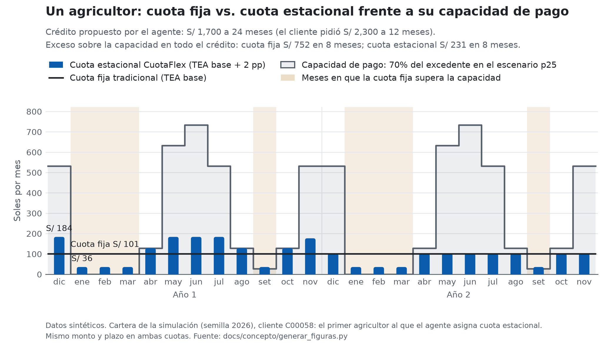
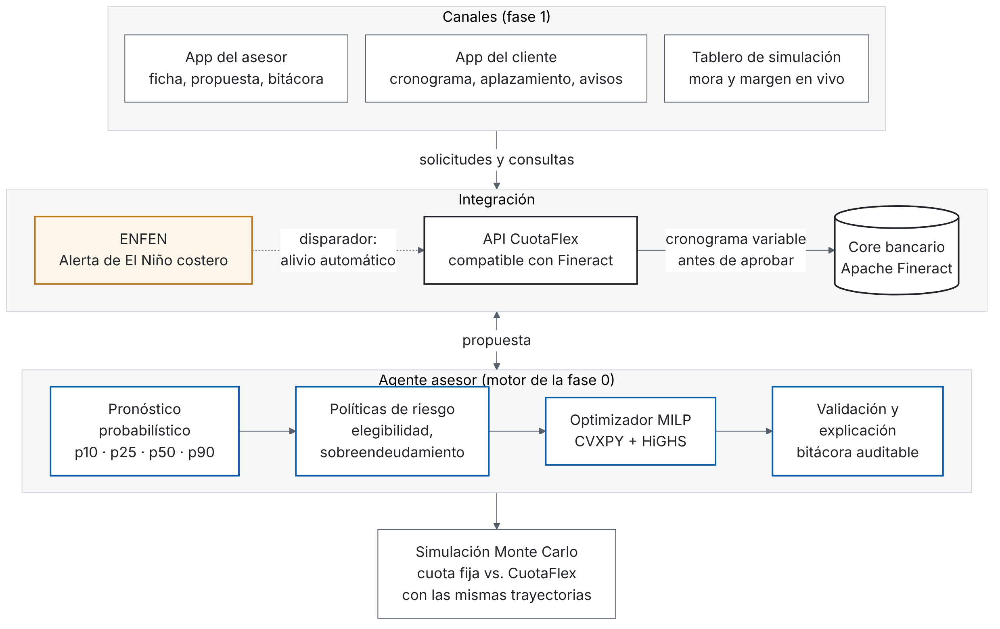
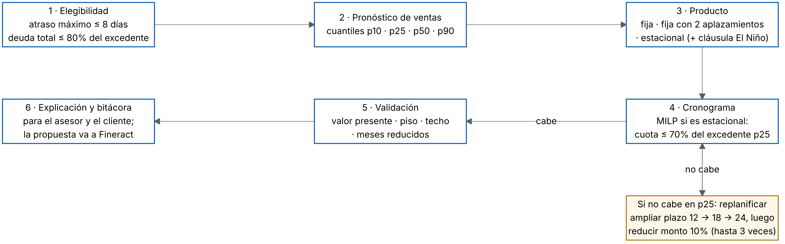

# CuotaFlex · Solution Concept

**Cajathón 2026 · Caja Trujillo · Eje 4 de inclusión financiera y resiliencia · Desafío NEG-01**

Equipo Sabado de paz (CJT-WG3TXH) · Versión 2 · 24 de noviembre de 2026 · Resultados de una simulación con datos sintéticos.

## Resumen ejecutivo

Los ingresos de los microempresarios de La Libertad varían con la siembra, las vedas y las campañas comerciales. CuotaFlex ayuda al asesor a elegir producto, monto y plazo mediante un pronóstico probabilístico, simulación de alternativas y un cronograma sujeto a políticas de riesgo. La alerta oficial del ENFEN habilita el alivio pactado para créditos elegibles. En 600 créditos sintéticos y 200 escenarios por crédito, el atraso mayor a 30 días baja de **10.4% a 4.8%**, el default de **4.8% a 2.1%** y el margen sobre la cartera sube de **19.2% a 25.7%**, con **16% menos colocación**. Manteniendo monto y plazo, el default baja a **3.5%**. El prototipo incluye tres apps, el espejo en Fineract y un agente que verifica cifras.

**Qué cambió desde la v1.** La calibración con las estadísticas de la SBS ajustó la cartera sintética para reducir el sesgo de una línea base estresada. La selección ahora simula cada modalidad elegible con escenarios del propio pronóstico. El backtest favoreció el perfil estacional del rubro con incertidumbre calibrada. Los resultados vigentes están en [Cambios de la fase 2][cambios].

## 1. Problema abordado

El reto NEG-01 busca alternativas de pago que sigan el flujo de ingresos de los microempresarios y preserven la sostenibilidad de la Caja.

- **Ingresos por temporadas.** En La Libertad la agricultura cobra en cosecha, la pesca alterna temporadas de captura con vedas, y el comercio y el calzado dependen de campañas. Una cuota idéntica cada mes puede coincidir con una caída temporal en el excedente disponible.
- **Mora como referencia de calibración.** Las cajas municipales registraron entre 5% y 5.7% de mora en microempresa durante 2026, según los datos de la SBS recogidos en [Cambios de la fase 2][cambios]. La SBS mide una foto mensual. En la simulación contamos créditos con al menos un atraso durante toda su vida.
- **Exposición a El Niño costero.** La última comprobación documentada por el equipo, del 23 de noviembre de 2026, registró la Alerta de El Niño Costero del Comunicado Oficial N.° 20-2026 (13 de noviembre). Un choque climático puede afectar a varios rubros al mismo tiempo. [Registro de ENFEN][enfen].

## 2. Concepto de solución

CuotaFlex propone producto, monto, plazo y cronograma a partir de la solicitud y el historial del cliente. El asesor revisa la propuesta y conserva la decisión de crédito. Tras el registro, el cliente ve sus cuotas y el costo del aplazamiento antes de confirmarlo. En los créditos con cláusula vigente, el ENFEN habilita el alivio y el cliente solicita su aplicación desde la app.

### 2.1 Modalidades y reglas

| Modalidad | Elegibilidad y selección | Regla principal |
|---|---|---|
| Cuota fija | Opción base para toda solicitud. La flexibilidad requiere buen historial y carga de deuda dentro del límite. | Pago regular durante todo el plazo. |
| Fija con aplazamientos | Alternativa evaluada por simulación si la solicitud es elegible para flexibilidad. | Permite pagar la cuota mínima en los aplazamientos habilitados. El saldo diferido se distribuye con intereses. |
| Estacional | Alternativa evaluada por simulación si la solicitud es elegible para flexibilidad. | Ajusta las cuotas al excedente mensual con un piso, un techo y un límite de meses reducidos. |

La cláusula de El Niño aplica a rubros expuestos como agricultura, pesca y comercio de campaña. Con alerta del ENFEN y alivios disponibles, el cliente puede reducir la próxima cuota al mínimo.

La política de referencia compara las modalidades elegibles y prioriza el menor default simulado entre las que respetan el límite de pérdida de **5%** del valor presente neto (VPN) respecto a la cuota fija. [Cambios de la fase 2][cambios].

### 2.2 Evidencia que respalda el diseño

El concepto inicial recogió experiencias de aplazamientos pactados en microcrédito y ajuste de cuotas a la estacionalidad. De esas referencias se conservaron el pago mínimo, la elegibilidad por historial y el disparador climático objetivo. La fase 2 aporta evidencia propia sobre la selección de la modalidad, la cobertura del pronóstico y el efecto de las cuotas flexibles con monto y plazo constantes. [Antecedentes del concepto v1](../CONCEPT_SOLUTION.md) · [Backtest][backtest].

### 2.3 Gestión de riesgos y transparencia

- **Capacidad de pago.** El optimizador minimiza cuánto se apartan las cuotas de la capacidad calculada con el escenario conservador p25. La bitácora registra los excesos remanentes y los chequeos de política. El asesor revisa las excepciones.
- **Sobreendeudamiento.** La elegibilidad tiene en cuenta el historial y la cuota nueva sumada a otras deudas. Ante un déficit, el motor prueba un plazo mayor y puede reducir el monto solicitado.
- **Rentabilidad.** El cronograma se ajusta para cerrar el valor presente del capital a la tasa del crédito. La simulación incorpora el costo de fondeo, los gastos operativos y las pérdidas para estimar margen neto.
- **Información al cliente.** El prototipo muestra la TEA, el cronograma y el costo adicional del aplazamiento antes de confirmarlo. La Caja debe validar la TCEA, los términos del contrato, el registro contable y el tratamiento regulatorio antes del piloto.
- **Salvaguardas del agente.** El agente toma cifras del motor y sus herramientas, valida las que aparecen en el texto y usa una plantilla cuando el borrador incumple las reglas. [Evaluación del agente][agente].

## 3. Impacto esperado

La comparación usa 600 créditos sintéticos y 200 escenarios por crédito (semilla 2026). Cada solicitud enfrenta las mismas trayectorias de ventas y El Niño en ambas estrategias. *Completo* permite ajustar el monto y el plazo. *Solo cronograma* conserva ambos y mide el aporte conjunto de la modalidad y sus condiciones de pago.

| Indicador | Cuota fija | CuotaFlex completo | Solo cronograma |
|---|---:|---:|---:|
| Créditos con atraso > 30 días | 10.4% | **4.8%** (−54%) | 7.5% (−28%) |
| Default (3 cuotas impagas seguidas) | 4.8% | **2.1%** (−57%) | 3.5% (−28%) |
| Margen neto / cartera | 19.2% | **25.7%** | 21.5% |
| Margen neto total (valor presente) | S/ 656 mil | **S/ 733 mil** (+S/ 78 mil) | S/ 733 mil (+S/ 77 mil) |
| Cartera colocada | S/ 3.41 M | **S/ 2.85 M** (−16%) | S/ 3.41 M |

Valores redondeados. Los cambios relativos y absolutos se calculan antes de redondear. [Resumen de resultados][resumen].

- **Aporte de las cuotas y del dimensionamiento.** Con monto y plazo constantes, el default baja 1.31 puntos porcentuales y el atraso baja 2.89. Al habilitar el dimensionamiento, se añaden 1.40 puntos de mejora en default y 2.65 en atraso. La colocación menor del modo completo explica parte de la mejora del margen por sol colocado.
- **Diferencias por rubro.** En el modo completo, el atraso baja de 30.4% a 14.3% en agricultura y de 32.7% a 17.0% en pesca. Con monto y plazo constantes, baja de 3.2% a 1.8% en calzado y de 2.0% a 1.0% en comercio de campaña.
- **Sensibilidad.** En el ensayo de 300 créditos y 100 escenarios, el default simulado con CuotaFlex queda por debajo de la cuota fija al variar por separado el ahorro del cliente, la probabilidad de El Niño o la volatilidad de las ventas. Si la volatilidad real duplica la estimada, el default pasa de 15.07% a 9.04%. [Análisis de sensibilidad][sensibilidad].
- **Alcance.** Las cifras describen escenarios sintéticos calibrados. Un piloto con la Caja debe medir el desempeño en su cartera.

*Figura 1. El motor calibrado elige cuota estacional para el agricultor sintético C00058. Con S/ 1,700 a 24 meses en ambas modalidades, la cuota fija supera su capacidad en 8 meses (S/ 752 en total) y la estacional en 8 (S/ 231). El exceso es la suma del monto que cada cuota rebasa el límite mensual de capacidad. [Generador](../generar_figuras.py).*

## 4. Enfoque tecnológico

1. **Pronóstico probabilístico.** El perfil del rubro aporta los cuantiles p10, p25, p50 y p90. En el backtest sintético fuera de muestra, el intervalo p10 a p90 alcanzó **79.5%** de cobertura y el error absoluto porcentual medio de p50 fue **16.5%**. [Reporte][backtest].
2. **Selección por simulación.** El agente compara fija, aplazamiento y estacional sobre escenarios del propio pronóstico. Aplica elegibilidad y el límite de VPN, y registra los resultados y el producto recomendado en la bitácora.
3. **Optimización y replanificación.** CVXPY y HiGHS calculan las cuotas estacionales con piso, techo, límite de meses reducidos y valor presente. Cuando falta capacidad, el motor prueba más plazo y ajusta el principal.
4. **Explicación verificable.** El asesor puede recalcular, simular y consultar políticas desde el chat. La evaluación sintética de 30 consultas por modo registró **100%** de exactitud numérica con plantillas y con un LLM simulado. El ensayo usó un proveedor simulado con rutas esperadas programadas. [Reporte][agente].
5. **Integración y alertas.** La API gestiona el ciclo del crédito en el core de demo y refleja el préstamo en Apache Fineract cuando el espejo está disponible. El lector consume el comunicado oficial del ENFEN y el tablero muestra la cartera cubierta. La demo usa un interruptor de alerta y un canal de notificaciones simulado. [Integración Fineract][fineract] · [Registro de ENFEN][enfen].

*Figura 2. Arquitectura base de canales, motor e integración. En v2, el disparador habilita el alivio y el cliente confirma su uso. [Fuente del diagrama](../img/arquitectura.mmd).*

*Figura 3. Secuencia base del motor. La fase 2 simula las modalidades elegibles al elegir el producto y el chat verifica las cifras cuando explica la propuesta. [Fuente del diagrama](../img/flujo-agente.mmd).*

## 5. Tecnología preexistente

| Etapa | Componentes disponibles antes de la final presencial |
|---|---|
| Fase 0 | Motor, optimizador, API simulada, Monte Carlo, generador sintético y pruebas del motor. |
| Fase 1 | Apps del asesor y del cliente, tablero y primera versión del concepto. |
| Fase 2 | Calibración de la cartera, backtesting, selección por simulación, espejo Fineract, ENFEN y agente con herramientas. |
| Fase 3 | Preparación de pruebas y guiones de la demo, modo sin conexión y materiales de presentación. |

El motor usa NumPy, pandas, SciPy, CVXPY y HiGHS. FastAPI expone la API y React sostiene las tres apps. Para la declaración de propiedad intelectual, el repositorio permite fechar cada componente y separar el trabajo previo de lo que se construya en la final. El equipo debe confirmar el tratamiento con la organización.

## 6. Funcionalidad crítica

La final debe mostrar que una solicitud produce una decisión explicable, que el cronograma llega al core y que el cliente puede actuar sobre la próxima cuota. Los tres perfiles sintéticos conectan esa secuencia.

| Caso | Qué se demuestra |
|---|---|
| **E001 · Rosa, agricultora de Chepén** | La cuota estacional sigue la siembra y la cosecha. El asesor verifica la propuesta y el cronograma. |
| **E002 · Martín, pescador de Pacasmayo** | La alerta habilita el alivio para su préstamo y el tablero muestra los créditos cubiertos. |
| **E003 · Luis, bodeguero de Trujillo** | El motor toma en cuenta otras deudas, reduce el monto si falta capacidad y explica la razón. |

La fase presencial permite contrastar el prototipo con datos y políticas que la Caja decida habilitar. El equipo registrará los cambios y separará los resultados del piloto de la simulación sintética.

## 7. Nivel de desarrollo esperado

El prototipo actual ejecuta la propuesta, el registro, el desembolso simulado, la consulta del cliente y la alerta de demo. El espejo con Fineract se probó en un entorno local. La final puede añadir validación con archivos anonimizados, revisión de políticas o una integración de prueba de la Caja, según los accesos disponibles. La puesta en producción requiere revisión de seguridad, autorización institucional y validación regulatoria.

## 8. Factibilidad y dependencias

| Insumo para el piloto | Uso | Respaldo en la demo |
|---|---|---|
| Ventas históricas o flujo declarado y calendario comercial | Calibrar la estacionalidad y la incertidumbre por rubro y región. | Historiales sintéticos. |
| Gasto familiar, obligaciones y comportamiento de pagos | Estimar capacidad de pago y revisar la política de elegibilidad. | Perfiles sintéticos y parámetros referenciales. |
| Tasas, plazos, costos, recuperación y criterios de riesgo | Calibrar margen, VPN y replanificación. | Configuración versionada del motor. |
| Entorno de prueba del core y datos anonimizados | Validar registro, montos y cronogramas de extremo a extremo. | Core simulado y espejo local en Fineract. |
| ENFEN y canal autorizado de aviso | Habilitar alivio y notificar de forma auditable. | Alerta de demo y bandeja de notificaciones simuladas. |

**Piloto propuesto.** Empezar con agricultura y pesca en La Libertad y comparar cohortes por rubro y región. Medir default, atraso, monto colocado, margen y carga de deuda. Revisar con el asesor los desacuerdos entre la recomendación y la decisión humana.

**Equipo.** Stefano Zamora, coordinación, simulación y tablero. Sebastian Pelaez, motor, API e integración. Joaquin Diaz, app del cliente, espejo de Fineract y QA de la demo. Andre Ramirez, agente con salvaguardas, concepto y pitch.

## Fuentes

- [Resultados de la cartera simulada][resumen] y [cambios de calibración y selección][cambios]. El comando `python scripts/simular.py` reproduce la comparación sintética.
- [Backtest fuera de muestra][backtest] y [análisis de sensibilidad][sensibilidad].
- [Evaluación numérica y de cumplimiento del agente][agente].
- [Disparador y comunicados oficiales del ENFEN][enfen] e [integración Fineract][fineract].

[resumen]: ../../../resultados/resumen.json
[cambios]: ../../../resultados/CAMBIOS_FASE2.md
[backtest]: ../../../resultados/backtest.md
[sensibilidad]: ../../../resultados/sensibilidad.md
[agente]: ../../../evaluacion/REPORTE.md
[enfen]: ../../../src/cuotaflex/integraciones/README_ENFEN.md
[fineract]: ../../../infra/fineract/README.md
