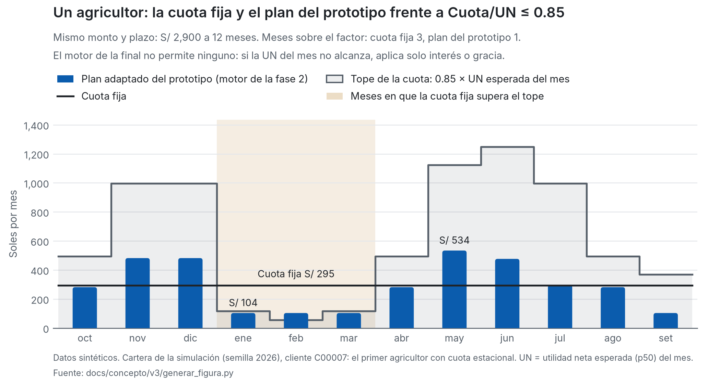
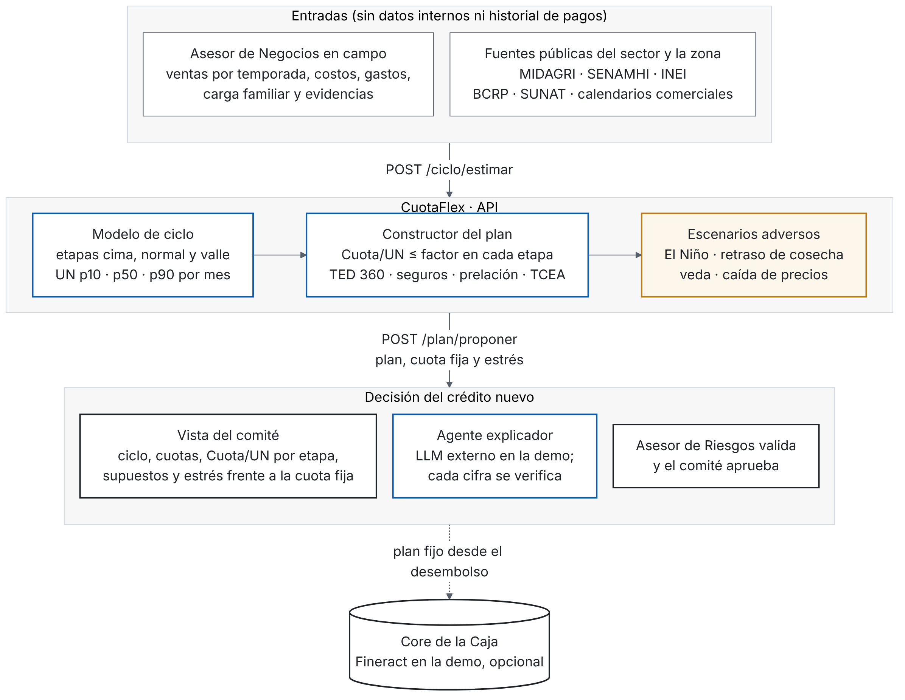
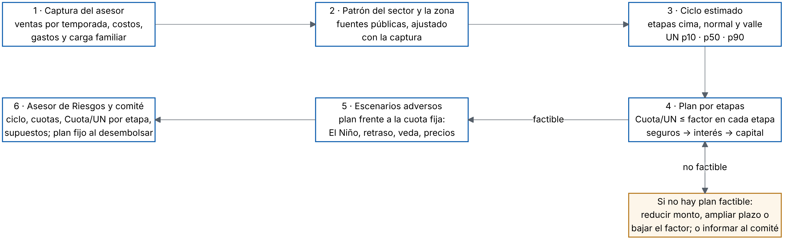

# CuotaFlex · Solution Concept

**Cajathón 2026 · Caja Trujillo · Eje 4 de inclusión financiera y resiliencia · Desafío NEG-01**

Equipo Sabado de paz (CJT-WG3TXH) · Versión 3 · 25 de noviembre de 2026 · Ajustada a las preguntas frecuentes del NEG-01 del 24 de noviembre · Cifras de escenarios sintéticos.

## Resumen ejecutivo

CuotaFlex es la herramienta del Asesor de Negocios para créditos nuevos de clientes con ingresos estacionales. Estima el ciclo económico del cliente con el patrón de su sector y su zona, tomado de fuentes públicas y ajustado con lo que el asesor levanta en campo, sin usar el historial de pagos. Con ese ciclo construye desde el inicio un plan de cuotas y periodos variables que cumple Cuota/UN ≤ factor del producto en cada etapa, con los costos de la Caja: TED base 360, seguros, prelación y TCEA. El Asesor de Riesgos y el comité ven el ciclo, las cuotas, Cuota/UN por etapa, los supuestos y la comparación con la cuota fija en escenarios adversos. En 600 clientes sintéticos, el prototipo actual baja de 45.8% a 34.3% los clientes con alguna etapa sobre el factor 0.85. El motor de la final lo impone en todas las etapas.

## 1. Problema abordado

> ¿Cómo podríamos ofrecer alternativas de pago que se ajusten a las variaciones de ingresos de los microempresarios, sin comprometer su capacidad de pago ni la sostenibilidad financiera de Caja Trujillo?
> — Pregunta de innovación del desafío NEG-01

- **La evaluación usa un ingreso promedio.** La capacidad de pago se mide con un ingreso promedio único, aunque en La Libertad la agricultura cobra en la cosecha, la pesca alterna temporadas con vedas, y el comercio y el calzado dependen de campañas. En el mes de valle, la cuota fija puede superar lo que el negocio deja.
- **El core solo genera cuotas fijas.** Según las preguntas frecuentes del reto, ese límite es del sistema, no de la normativa. Al asesor le faltan herramientas para estimar el ciclo del cliente y convertirlo en un plan que el comité pueda revisar.
- **Riesgo climático de la región.** El ENFEN mantiene la Alerta de El Niño Costero (Comunicado Oficial N.° 20-2026, 13 de noviembre), un choque que puede golpear a varios rubros a la vez. [Registro del ENFEN][enfen].
- **Contexto.** Las cajas municipales registraron entre 5% y 5.7% de mora en microempresa durante 2026, según la SBS. [Cambios de la fase 2][cambios].

## 2. Concepto de solución

CuotaFlex trabaja sobre **créditos nuevos**: admisión, ampliación o recuperación. El plan se define antes del desembolso y no cambia durante el crédito. Modificar un crédito vigente sería una reprogramación, que queda fuera del alcance del reto.

| Usuario | Qué hace en CuotaFlex |
|---|---|
| Asesor de Negocios | Levanta en campo las ventas por temporada, los costos, los gastos, la carga familiar y las evidencias. Estima el ciclo y propone el plan en la misma herramienta. |
| Asesor de Riesgos | Valida el ciclo, los supuestos, Cuota/UN por etapa y el estrés frente a la cuota fija. |
| Comité | Aprueba con una vista que muestra el ciclo en gráfico, las cuotas, Cuota/UN por etapa, los supuestos y los escenarios adversos. |

### 2.1 Cómo se construye el plan

1. **Ciclo estimado.** Cada mes del plazo tiene una utilidad neta esperada (UN), con cuantiles p10, p50 y p90, y una etapa: **cima**, **normal** o **valle**, según su UN frente a la mediana del cliente. La UN ya descuenta costos, gastos operativos y tributarios, otras deudas y la carga familiar.
2. **Cuotas desde el ciclo, no desde una cuota fija.** Cada cuota puede tener un monto y un periodo distintos, por ejemplo una cuota en la fecha de cosecha. En la **cima** se amortiza el máximo de capital. En el **valle** se cubren primero seguros e intereses, y capital solo si alcanza. La gracia y los meses de solo interés se usan con cautela, con un tope por producto.
3. **Capacidad de pago por etapa.** En cada etapa con cuota se cumple **Cuota ÷ UN esperada ≤ factor del producto**, por ejemplo 0.65 en inclusión y 0.85 en pequeña empresa. Si la UN del mes es ≤ 0, la cuota es 0. El asesor puede usar un factor menor.
4. **Costos como los de la Caja.** La TEA se convierte en tasa diaria base 360, TED = (1 + TEA)^(1/360) − 1, y se aplica por días exactos sobre el saldo de capital. El desgravamen se calcula sobre el saldo y el multirriesgo sobre el valor asegurable, con interés simple por días. La **prelación** es seguros → interés → capital. Lo no cubierto queda **pendiente sin capitalizar** y se paga primero en el periodo siguiente. Se muestra la **TCEA**, y la TEA es editable sin pasar el tope del BCRP.
5. **Sin plan factible,** el motor calcula el monto máximo o el plazo mínimo que sí cumplen el factor. Si el asesor no los acepta, el caso llega al comité con esa información.

### 2.2 Evidencia que respalda el diseño

Los antecedentes del concepto v1 sostienen dos decisiones. Ajustar las cuotas a la temporada baja no empeoró el impago en Bangladesh rural. En cambio, dos meses de gracia sin condiciones elevaron el impago a 24 semanas de 2% a 9% en Kolkata: por eso la gracia se usa con tope y solo donde el ciclo la justifica. [Antecedentes del concepto v1][v1].

### 2.3 Gestión de riesgos y transparencia

- **Capacidad de pago.** La regla Cuota/UN ≤ factor se verifica en cada etapa con la UN esperada de esa etapa, no con el promedio.
- **Sobreendeudamiento.** La UN ya descuenta otras deudas y la carga familiar, así que el plan no se apoya en ingresos comprometidos.
- **Incertidumbre.** El ciclo trae cuantiles y escenarios adversos: El Niño, retraso de cosecha o veda extendida según el sector, y caída de precios. El comité ve cómo responden el plan y la cuota fija en cada uno.
- **Errores de captura.** El ciclo parte del patrón público del sector y la zona. Si el asesor marca meses distintos, prevalece el cliente y queda registrado como supuesto. Las evidencias, como Yape o boletas, acotan el nivel de ventas.
- **Transparencia.** El cliente recibe antes de firmar el cronograma completo, los seguros y la TCEA.
- **Agente.** Toda cifra que explica sale del ciclo, del plan o de una herramienta. Si un borrador del LLM trae una cifra que no se puede verificar, se usa la plantilla.

## 3. Impacto esperado

Según las preguntas frecuentes, no se medirá la mora de una cartera real. Se evalúan la precisión y el sustento del ciclo, el ajuste del cronograma al ciclo y la comparación con la cuota fija en escenarios sintéticos, incluidos los adversos. Por eso la tabla principal mide **Cuota/UN por etapa**.

Las cifras son del **prototipo actual** (motor de la fase 2), sobre 600 clientes sintéticos con el mismo monto y plazo y la UN esperada de cada mes. Una etapa supera el factor cuando Cuota/UN es mayor que el factor, o cuando hay cuota con UN ≤ 0. [Cifras][cifras].

| Métrica | Cuota fija | Plan adaptado (prototipo actual) |
|---|---:|---:|
| Clientes con alguna etapa donde Cuota/UN > 0.85 | 45.8% | **34.3%** |
| Etapas por crédito con Cuota/UN > 0.85 (promedio) | 2.39 | **1.60** |
| Clientes con alguna etapa donde Cuota/UN > 0.65 | 56.0% | **39.0%** |
| Escenario El Niño · clientes con alguna etapa > 0.85 | 62.7% | **55.0%** |
| Interés total medio por crédito | S/ 2,060 | S/ 2,030 |

| Rubro (factor 0.85, escenario esperado) | Cuota fija | Plan adaptado |
|---|---:|---:|
| Agricultura | 100% | 78% |
| Pesca | 100% | 95% |
| Calzado | 71% | 34% |
| Comercio de campaña | 27% | 18% |

**Cómo leer estas cifras**

- **El prototipo reduce los incumplimientos del factor, pero no los elimina en agricultura y pesca.** Hoy exige un piso de cuota incluso en el valle, cuando la UN puede ser mínima o negativa.
- **En el escenario El Niño** baja la proporción de clientes afectados, pero no las etapas sobre el factor por crédito: son 7.2 con ambos planes. El estrés informa al comité; el cronograma no lo resuelve por sí solo.
- **En bodega y servicios** casi no hay etapas sobre el factor: 0% con la cuota fija y 2% con el plan del prototipo.
- **El costo no sube.** El interés total medio es similar: S/ 2,060 con la cuota fija y S/ 2,030 con el plan adaptado.
- **Diseño comprometido para la final.** El motor de la fase 4 impone Cuota/UN ≤ factor en cada etapa como **restricción dura**, con gracia o solo interés en el valle y pendientes sin capitalizar. Por construcción, ningún plan propuesto superará el factor; si no existe plan factible, propone menos monto o más plazo, o lo informa al comité. Sus cifras se publicarán en `resultados/factor_por_etapa.md`.
- La simulación de mora de cartera del concepto v2 queda como referencia, pero no es un criterio de evaluación.

*Figura 1. El agricultor sintético C00007, con S/ 2,900 a 12 meses. La cuota fija supera el tope en 3 meses de valle y el plan del prototipo en 1. El motor de la final no permite ninguno. [Generador](generar_figura.py).*

## 4. Enfoque tecnológico

CuotaFlex no es un tablero ni un chatbot: estima un ciclo con incertidumbre, optimiza un plan con restricciones de riesgo y explica cada cifra después de verificarla.

1. **Modelo de ciclo.** Combina el patrón del sector y la zona, tomado de fuentes públicas (MIDAGRI, SENAMHI, INEI, BCRP, SUNAT, PRODUCE o IMARPE y calendarios comerciales), con la captura del asesor. Entrega la UN de cada mes con cuantiles calibrados y no usa el historial de pagos. En el backtest sintético fuera de muestra del pronóstico actual, el intervalo p10 a p90 cubrió el **79.5%** de los casos y el MAPE de p50 fue **16.5%**. El modelo de la fase 4 se valida con el mismo criterio, con una cobertura objetivo de 80%. [Backtest][backtest].
2. **Constructor del plan.** Con CVXPY y HiGHS, la restricción dura es cuota ≤ factor × UN en cada etapa, con cuota 0 si la UN es ≤ 0. La deuda termina en 0 y hay un máximo de meses de gracia. El objetivo minimiza primero el costo total, interés más seguros, lo que concentra la amortización en la cima; después penaliza la gracia y los saltos bruscos entre periodos. Aplica la TED por días, los seguros, la prelación y los pendientes, y calcula la TCEA. La cuota fija de comparación sale del mismo motor, para que la comparación sea justa.
3. **Escenarios adversos.** El Niño, retraso de cosecha o veda extendida según el sector, y caída de precios. Para cada uno se comparan el plan y la cuota fija: etapas sobre el factor, ratio máximo y monto sobre la capacidad.
4. **Agente para el asesor y el comité.** Explica por qué cada cuota tiene ese monto, compara con la cuota fija, prueba escenarios y redacta una justificación para el comité. Las preguntas frecuentes permiten un LLM externo vía API para la demo. Toda cifra sale del contrato o de una herramienta y se verifica antes de mostrarse, y hay un modo sin conexión con plantillas.
5. **Integración opcional.** Fineract sirve para demostrar que un core puede recibir un cronograma variable. El prototipo no se conecta a la Caja.

*Figura 2. Arquitectura del concepto v3, según los contratos de la fase 4. [Fuente del diagrama](img/arquitectura-v3.mmd) · [Contratos][contratos].*

*Figura 3. Del ciclo al plan aprobado; se lee en forma de S. [Fuente del diagrama](img/flujo-plan-v3.mmd).*

## 5. Tecnología preexistente

| Etapa | Componentes disponibles antes de la final presencial |
|---|---|
| Fase 0 | Motor, optimizador, API simulada, Monte Carlo, generador sintético y pruebas del motor. |
| Fase 1 | Apps del asesor y del cliente, tablero y primera versión del concepto. |
| Fase 2 | Calibración de la cartera, backtesting, selección por simulación, espejo Fineract, ENFEN y agente con herramientas. |
| Fase 3 | Preparación de pruebas y guiones de la demo, modo sin conexión y materiales de presentación. |
| Fase 4 (en curso) | Adaptación a las preguntas frecuentes: modelo de ciclo con fuentes públicas, plan por etapas con los costos de la Caja, vista del comité y agente explicador. |

El motor usa NumPy, pandas, SciPy, CVXPY y HiGHS. FastAPI expone la API y React sostiene las apps. Para la declaración de propiedad intelectual, el repositorio permite fechar cada componente y separar el trabajo previo de lo que se construya en la final.

## 6. Funcionalidad crítica

La final mostrará tres cosas: que el Asesor de Negocios estima el ciclo y propone el plan **en la misma herramienta**; la **vista para el Asesor de Riesgos y el comité**, con el ciclo en gráfico, las cuotas, Cuota/UN por etapa y los supuestos; y la **comparación con la cuota fija en escenarios adversos**.

| Caso | Qué se demuestra |
|---|---|
| **E001 · Rosa, arroz en Chepén** | Cuotas concentradas en la cosecha y gracia en la siembra, con la deuda en 0 al final y la TCEA. |
| **E002 · Martín, pesca artesanal en Pacasmayo** | La veda y El Niño como escenarios adversos: el comité ve cómo responden el plan y la cuota fija. |
| **E003 · Luis, bodega en Trujillo** | Con su factor, el monto pedido no es factible y el motor propone el monto máximo que sí cumple. |

## 7. Nivel de desarrollo esperado

Al cierre de la hackathon esperamos un prototipo web funcional, no productivo, que ejecute los tres casos de punta a punta. Incluye la captura y el ciclo con fuentes públicas, el plan por etapas con los costos de la Caja y la TCEA, la vista del comité con el estrés frente a la cuota fija, y el agente que explica con cifras verificadas, con LLM externo o en modo sin conexión. Tendrá pruebas automatizadas y usará solo datos sintéticos. No se conecta a la Caja; la puesta en producción requeriría revisión de seguridad, autorización institucional y validación regulatoria.

## 8. Factibilidad y dependencias

### 8.1 Lo que ya funciona

- El prototipo actual corre el motor con pronóstico y optimizador, la API, las apps, el agente con salvaguardas numéricas, el modo sin conexión y un despliegue de demo, con pruebas automatizadas.
- La fase 4 trabaja contra contratos definidos, `/ciclo/estimar` y `/plan/proponer`, con ejemplos JSON, para que los cuatro lotes avancen en paralelo. [Contratos][contratos].

### 8.2 Parámetros que se solicitan a la Caja

La Caja no entregará datos de clientes y el prototipo no los necesita. El ciclo se apoya en fuentes públicas en lugar de datos internos. A la Caja solo le pedimos **parámetros** de sus productos:

| Parámetro | Para qué se usa | En la demo |
|---|---|---|
| Factor Cuota/UN por producto | Restricción del plan en cada etapa | 0.85 en pequeña empresa y 0.65 en inclusión |
| Tasas de los seguros de desgravamen y multirriesgo | Costo del crédito y prelación | Desgravamen de 0.077% mensual en el ejemplo del contrato |
| TEA por producto y su tope | Validar la TEA editable | Configurable, sin pasar el tope del BCRP |
| Política de gracia y de solo interés | Máximo de meses por producto | 4 meses en el ejemplo del contrato |

### 8.3 Dependencias y riesgos

| Dependencia o riesgo | Mitigación |
|---|---|
| Fuentes públicas incompletas para una actividad o zona | Patrón regional del sector, marcado como supuesto y visible para el comité |
| Error en la captura del asesor | Evidencias, patrón público como referencia, sensibilidad de ±20% y supuestos a la vista |
| UN negativa en el valle | Cuota 0 con tope de meses de gracia; si no alcanza, menos monto o más plazo |
| LLM externo no disponible o lento | Modo sin conexión con plantillas |
| Normas de transparencia, seguros y tope de TEA | Validarlas con las áreas Legal y de Riesgos antes de un piloto |

### 8.4 Equipo

Stefano Zamora coordina y lleva el flujo del asesor y la vista del comité. Sebastian Pelaez lleva el motor financiero y el constructor del plan. Joaquin Diaz lleva el modelo del ciclo económico con fuentes públicas. Andre Ramirez lleva el concepto, el pitch y el agente para el comité.

## Fuentes

- Preguntas frecuentes del NEG-01, publicadas el 24 de noviembre de 2026 en la plataforma del Cajathón.
- [Cifras de Cuota/UN del prototipo actual][cifras]. Se reproducen con `python docs/concepto/v3/cifras_cuota_un.py`.
- [Backtest del pronóstico][backtest] y [cambios de la fase 2 con los datos de la SBS][cambios].
- [Contratos de la fase 4][contratos] y [registro de comunicados del ENFEN][enfen].
- [Concepto v1 con sus antecedentes][v1].

[cifras]: cifras_cuota_un.json
[backtest]: ../../../resultados/backtest.md
[cambios]: ../../../resultados/CAMBIOS_FASE2.md
[contratos]: ../../fases/fase-4/CONTRATOS.md
[enfen]: ../../../src/cuotaflex/integraciones/README_ENFEN.md
[v1]: ../CONCEPT_SOLUTION.md
