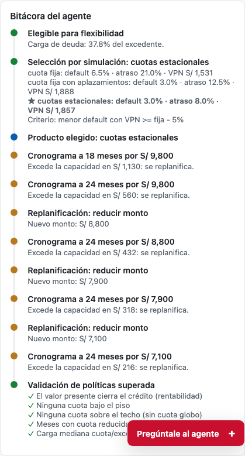
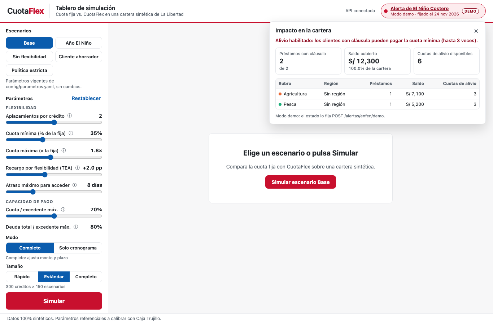
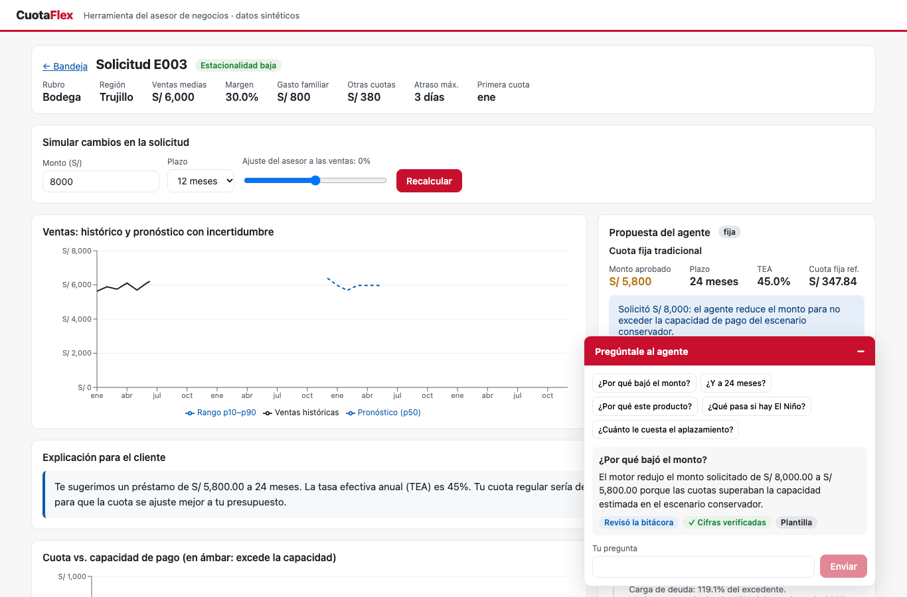

# CuotaFlex en cinco minutos

Los tres casos son sintéticos. Aparecen primero en la bandeja del asesor por su código. Cada caso trae 24 meses de ventas reproducibles. El argumento `n` de `/motor/cartera-demo` sigue indicando cuántas solicitudes sintéticas adicionales se devuelven.

Prepara los cuatro servicios con el [modo sin conexión](OFFLINE.md). Abre la [bandeja del asesor](http://127.0.0.1:5173) y el [tablero](http://127.0.0.1:5175). En la app del cliente, usa el número que muestra **Registro en el core**. Los números de préstamo se asignan en cada ejecución.

## E001 · Rosa, agricultora de arroz en Chepén

1. Abre **E001** en la bandeja. En **Bitácora del agente**, señala **Selección por simulación: cuotas estacionales**. Las modalidades candidatas muestran un default estimado de **6,5 %** para la cuota fija y **3,0 %** para la estacional. El VPN simulado de la modalidad elegida cumple el criterio de selección.
2. En **Cuota vs. capacidad de pago** o **Cronograma propuesto**, compara enero a marzo del primer año, con cuotas de **S/ 150,91**, con mayo a julio, con **S/ 776,13**. Señala que la propuesta de **S/ 7.100 a 24 meses** incluye la cláusula de El Niño.
3. Abre **Pregúntale al agente** y pulsa **¿Y a 24 meses?**. Señala el distintivo **Cifras verificadas** y abre **Aplicar a la ficha** para mostrar la vista previa. Cierra el chat y en **Registro en el core** elige **Registrar solicitud**, **Aprobar** y **Desembolsar**.
4. Abre `http://127.0.0.1:5174/?loanId=<número>`. Muestra la próxima cuota y pulsa **Ver mi cronograma**. Puedes añadir que la comparativa de la ficha estima **10,0 % → 0,0 %** de default en 300 escenarios para la solicitud original fija frente a la propuesta ajustada. Esa comparativa también incorpora el cambio de monto y plazo.

> «Rosa vende más en cosecha. El motor compara las modalidades y concentra una parte de las cuotas en los meses con más capacidad de pago.»

[Chat y vista previa](capturas/02-asesor-e001-chat.png) · [Aprobación](capturas/03-asesor-e001-aprobacion.png) · [Desembolso](capturas/04-asesor-e001-desembolso.png) · [Próxima cuota](capturas/05-cliente-e001-proxima-cuota.png) · [Cronograma](capturas/06-cliente-e001-cronograma.png)

## E002 · Martín, pescador artesanal en Pacasmayo

1. En la app del asesor, abre **E002**, registra, aprueba y desembolsa. Abre `http://127.0.0.1:5174/?loanId=<número>&demo=1` y muestra la primera cuota de **S/ 315,80**.
2. En el **Panel de demo** activa **Alerta El Niño**. Vuelve al comienzo de la pantalla y muestra el banner. En el tablero, abre el distintivo **Alerta de El Niño Costero** y señala **Saldo cubierto** y la fila **Pesca**, con **S/ 5.200** de saldo y **3** cuotas de alivio disponibles.
3. Vuelve a la app del cliente y pulsa **Usar alivio**. La próxima cuota baja a **S/ 110,53**. El saldo diferido se reparte en cuotas posteriores con intereses. Si también desembolsaste a Rosa, la cartera de esta sesión muestra **S/ 12.300** cubiertos entre ambos préstamos.

> «La alerta habilita el alivio de la cláusula. Martín paga menos en la próxima cuota y puede revisar cómo queda su cronograma.»

[Banner con la cuota original](capturas/07-cliente-e002-alerta.png) · [Cuota después del alivio](capturas/09-cliente-e002-alivio.png)

## E003 · Luis, bodeguero en Trujillo

1. Abre **E003** en la bandeja. Luis ya paga **S/ 380** por otras deudas. Señala la solicitud por **S/ 8.000** y el monto propuesto de **S/ 5.800 a 24 meses** en la ficha.
2. En **Bitácora del agente**, señala la carga de deuda sobre el excedente, del **119,1 %** en la solicitud inicial, y el paso **Replanificación: reducir monto**.
3. Abre **Pregúntale al agente** y pulsa **¿Por qué bajó el monto?**. Muestra la explicación de capacidad de pago con los dos montos y el distintivo de verificación.

> «El motor tiene en cuenta las cuotas de otras deudas y ajusta el monto al presupuesto de Luis. El asesor puede ver qué motivó el cambio.»

[Bitácora y replanificación](capturas/12-asesor-e003-reduccion.png)

## Si el jurado pide ver el tablero

En **Tamaño**, elige **Rápido** y compara **Base** con **Año El Niño**. Los cuatro indicadores muestran atraso, default, margen neto y cartera colocada en 150 créditos y 80 escenarios. [Escenario Base](capturas/10-tablero-base.png) · [Escenario Año El Niño](capturas/11-tablero-ano-el-nino.png)
