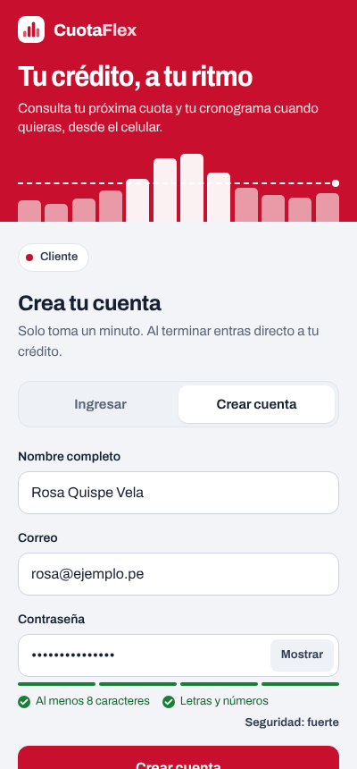
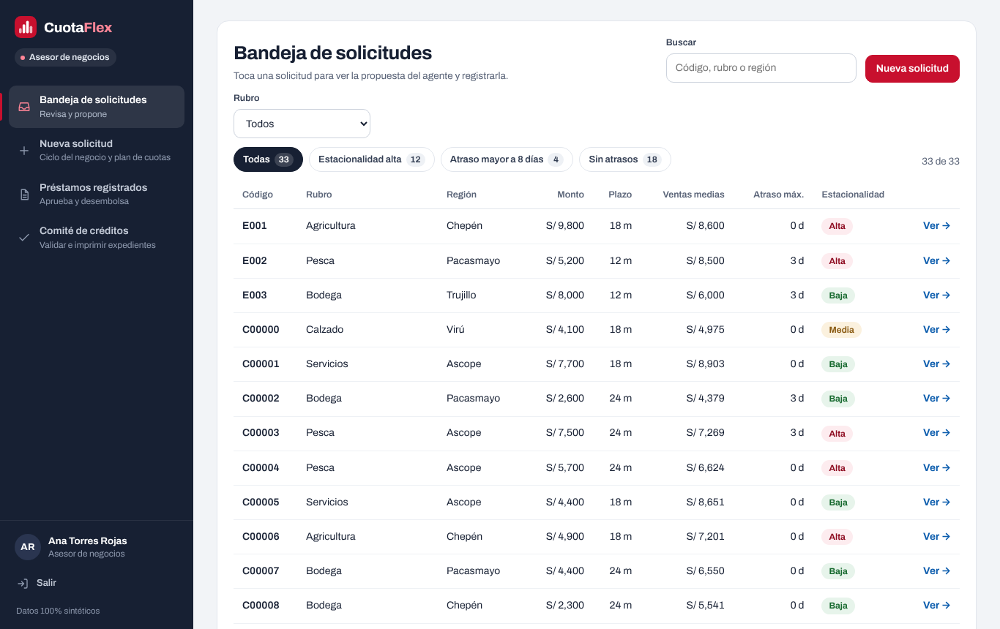
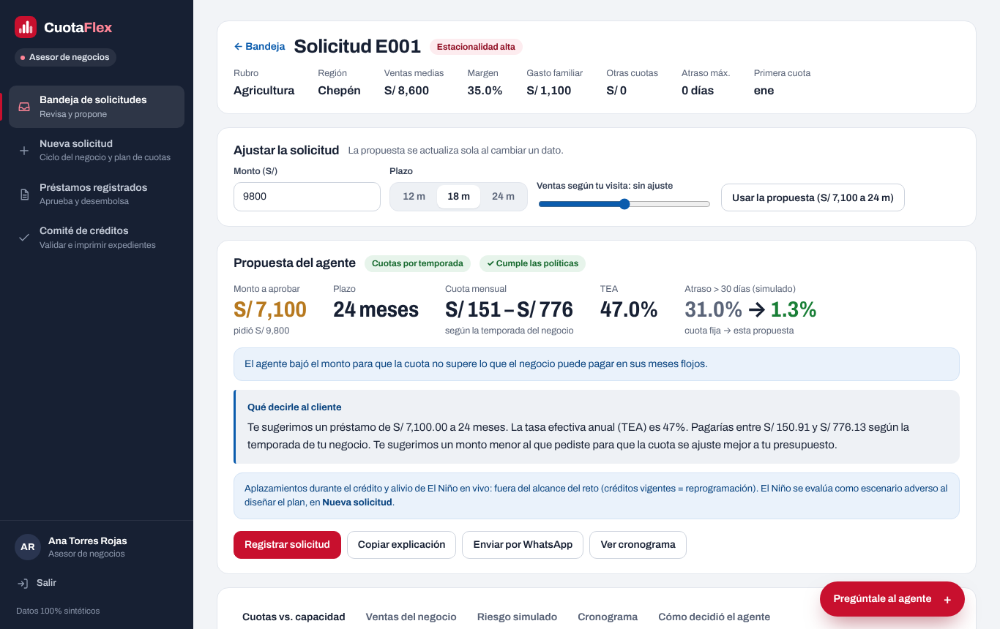
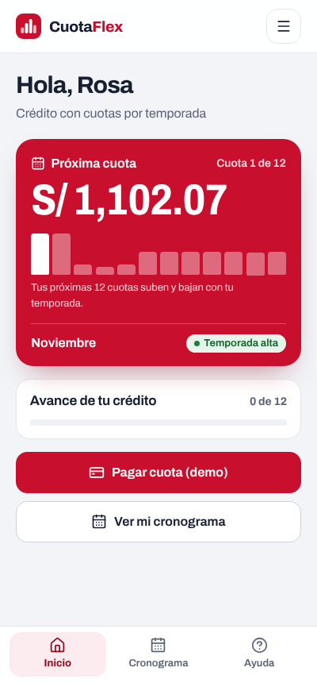
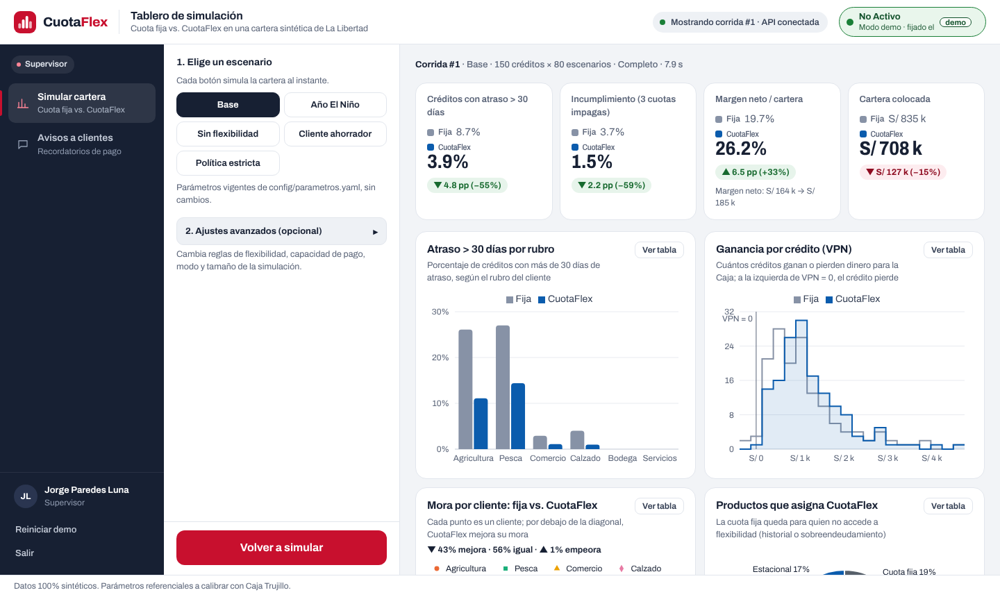

# Sistema de diseño de CuotaFlex

Una sola identidad para las tres apps (asesor, cliente y tablero) y la portada. Moderno, pero serio:
es una herramienta de crédito de Caja Trujillo.

## Ideas que lo guían

1. **El rojo es Caja Trujillo.** Se usa para la marca y para la acción principal de cada pantalla.
   No se usa como adorno (se quitaron las líneas rojas bajo las cabeceras).
2. **Las cifras mandan.** Montos, cuotas y KPI van en Archivo condensada y con números tabulares. Es el dato
   que miran el asesor, el cliente y el supervisor.
3. **Un solo adorno, y con sentido: el ritmo de cuotas.** Barras que suben y bajan con la temporada frente a la
   línea de una cuota fija. Es la idea del producto. Aparece en el símbolo de la marca, en la pantalla de acceso,
   en la portada y, con los datos reales, en la tarjeta de la próxima cuota del cliente.
4. **Calma alrededor.** Hojas blancas con borde fino sobre un fondo gris azulado. La sombra queda solo para lo que
   flota: menús, chat del agente, modales y barras fijas.

## Tokens (`web/*/src/tema.css`)

| Token | Valor | Uso |
|---|---|---|
| `--cf-rojo` | `#C8102E` | marca, acción principal (hover `--cf-rojo-hover` `#A50D26`) |
| `--cf-rojo-osc` / `--cf-rojo-suave` | `#8E0B20` / `#FDECEF` | textos y fondos de alerta |
| `--cf-tinta` (= `--cf-gris-900`) | `#172033` | texto y menú lateral |
| `--cf-gris-600` | `#5A6478` | texto secundario (5.9:1 sobre blanco) |
| `--cf-gris-200` / `--cf-gris-100` | `#E2E6ED` / `#EEF1F5` | bordes finos / fondos de grupos |
| `--cf-fondo` | `#F2F4F7` | fondo de las apps |
| `--cf-azul` | `#0B5CAD` | serie CuotaFlex en gráficos, enlaces, foco |
| `--cf-verde`, `--cf-ambar` | `#1A7F37`, `#B7791F` | estados (con su versión `-osc` para texto y `-suave` para fondo) |
| `--cf-radio-sm` / `--cf-radio` / `--cf-radio-lg` | 8 / 12 / 16 px | controles / tarjetas pequeñas / hojas |

Gráficos: la cuota fija va en pizarra `#8792A6` y CuotaFlex en azul `#0B5CAD`. El par pasa el control de distinción
para visión normal y daltonismo (ΔE 21; el gris anterior, `#57606A`, quedaba en 12.8). El texto de las leyendas usa la tinta.

## Tipografía

**Archivo** (Omnibus-Type, fundidora argentina; licencia OFL), variable en peso y ancho. Va empaquetada con cada app
(`@fontsource-variable/archivo`), así que funciona sin internet, como pide la demo sin conexión.

- Texto: 14 px en asesor y tablero, 16 px en el cliente.
- Títulos: peso 680–720, interletrado ligeramente negativo.
- Cifras grandes: clase `.cf-cifra` o `font-stretch: var(--cf-cifra-ancho)` (84 %) con `tabular-nums`.

## Componentes compartidos (copias idénticas en las 3 apps)

| Archivo | Qué tiene |
|---|---|
| `tema.css` | tokens, base, marca, ritmo de cuotas y pantalla de acceso |
| `marca.tsx` | `<Marca />` (símbolo y nombre), `<Simbolo />` y `<Ritmo />` |
| `sesion.tsx` | `<ConSesion>`: ingresar, crear cuenta o PIN; `usuarioSesion()` y `cerrarSesion()` |

Cada app se compila sola (Docker copia solo `web/<app>/`), por eso van copiados. **Si cambias uno, copia la versión de
`web/asesor/src/` a las otras dos.** `tests/test_web_tema.py` falla si las copias se separan.

## De dónde salió cada decisión

Se mezclaron las referencias con una sola regla: que todo se vea de la misma familia.

- **ui-ux-pro-max-skill:** para banca y finanzas recomienda estilo sobrio de tipo suizo, accesible y que transmita
  confianza. De ahí salen la paleta contenida, las reglas de contraste 4.5:1, los objetivos táctiles de 44 px y los
  formularios con errores junto al campo.
- **anthropics/skills (frontend-design):** una idea fuerte y lo demás tranquilo (el ritmo de cuotas), tipografía elegida
  para el tema y textos simples desde el punto de vista de quien usa la app.
- **vercel-labs/agent-skills (web-design-guidelines):** foco visible, `autocomplete` en cada campo, pegar permitido,
  `aria-live` en avisos, `prefers-reduced-motion`, `…` en estados de carga y transiciones solo de propiedades concretas.
- **RareUI:** la entrada del PIN en casillas, al estilo de su OTP Input, hecha en CSS sin dependencias nuevas.
- **Lucian UX/UI:** patrones de acceso (pestañas con indicador que se desliza, medidor de seguridad de la contraseña,
  la tarjeta que se sacude ante una contraseña incorrecta), reescritos con los tokens de CuotaFlex.

No se agregaron Tailwind ni librerías de animación: el diseño vive en CSS con variables, como ya estaba el proyecto.

## Accesibilidad

Contraste AA en texto, foco visible en todo control, navegación por teclado en las pestañas de acceso (flechas),
errores asociados a su campo (`aria-describedby`) y movimiento reducido cuando el sistema lo pide.

## Capturas

| | |
|---|---|
|  |  |
|  |  |
|  |  |
