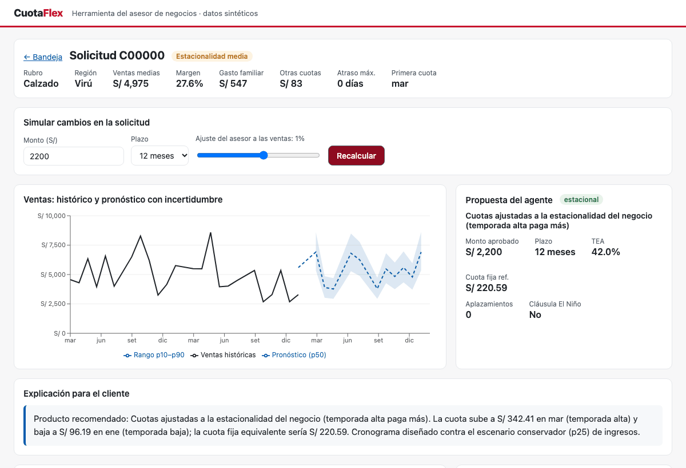

# CuotaFlex con Apache Fineract

El router de CuotaFlex replica el préstamo del core simulado en Apache Fineract 1.12.1, aplica las cuotas variables y refleja su estado de aprobación y desembolso. PostgreSQL 16.15 guarda los datos del demo en un volumen local. Las dos imágenes están fijadas por versión y digest. [Documentación de Fineract 1.12.1](https://fineract.apache.org/docs/1.12.1/) · [Compose oficial de PostgreSQL](https://github.com/apache/fineract/blob/1.12.1/docker-compose-postgresql.yml) · [Variables de PostgreSQL](https://github.com/apache/fineract/blob/1.12.1/config/docker/env/fineract-postgresql.env)

La imagen ejecutada identifica el tag exacto como `1.12.1` en `/actuator/info`. Swagger muestra el metadato de compilación `1.13.1-SNAPSHOT`. El endpoint `/core/estado` informa el tag exacto de la instancia.

## Arranque local

Ejecuta estos comandos desde la raíz del repositorio con Docker Compose v2 y Python 3.10 o posterior.

```bash
infra/fineract/up.sh
python -m venv .venv
source .venv/bin/activate
python -m pip install -r requirements.txt

entorno=infra/fineract/.env.example
if [ -f infra/fineract/.env ]; then entorno=infra/fineract/.env; fi
set -a
source "$entorno"
set +a

python scripts/seed_fineract.py
PYTHONPATH=src uvicorn cuotaflex.api.main:app --host 127.0.0.1 --port 8000
```

Para Windows, sigue el procedimiento de PowerShell o la alternativa WSL2 de abajo.

Compose usa `.env.example` como configuración de demo y admite un `.env` local. El certificado autofirmado corresponde a la instancia de demo en loopback, por eso el ejemplo configura `FINERACT_VERIFY_SSL=false`. Si modificas el puerto, actualiza `FINERACT_PORT` y `FINERACT_URL`. Los lanzadores imprimen las direcciones de la API y Swagger cuando la instancia está lista.

El seed reutiliza la oficina raíz, activa PEN y prepara un asesor de demo y el producto **CuotaFlex Microempresa**. Guarda sus IDs en `infra/fineract/ids.json`. El producto usa cuota francesa sobre saldo decreciente, tasa mensual derivada de la TEA, dos decimales e intervalos de 5 a 90 días entre cuotas.

## Windows con Docker Desktop

1. Activa WSL2 y abre Docker Desktop con contenedores Linux. En **Settings → General**, selecciona **Use the WSL 2 based engine**. Comprueba que `docker info --format '{{.OSType}}'` devuelva `linux`. [Instalación de Docker Desktop](https://docs.docker.com/desktop/setup/install/windows-install/) · [Motor WSL2 de Docker](https://docs.docker.com/desktop/features/wsl/)
2. Desde la raíz del repositorio en PowerShell, arranca los contenedores y mide memoria. La primera vez, con internet, ejecuta el comando sin `-SinDescargas` para que Compose descargue las imágenes fijadas. Después usa el parámetro para confirmar que las imágenes ya están en la laptop.

   ```powershell
   .\infra\fineract\up.ps1
   .\infra\fineract\up.ps1 -SinDescargas
   ```

3. Prepara el entorno y el seed en la misma terminal. El siguiente bloque carga la configuración de demo o el archivo `.env` local sin imprimir sus valores.

   ```powershell
   py -3.12 -m venv .venv
   .\.venv\Scripts\python.exe -m pip install -r requirements.txt
   $archivo = if (Test-Path infra/fineract/.env) { 'infra/fineract/.env' } else { 'infra/fineract/.env.example' }
   Get-Content $archivo | ForEach-Object {
       if ($_ -match '^([A-Z_][A-Z0-9_]*)=(.*)$') {
           [Environment]::SetEnvironmentVariable($Matches[1], $Matches[2], 'Process')
       }
   }
   .\.venv\Scripts\python.exe scripts/seed_fineract.py
   $env:PYTHONPATH = 'src'
   .\.venv\Scripts\python.exe -m uvicorn cuotaflex.api.main:app --host 127.0.0.1 --port 8000
   ```

4. Desde otra terminal, usa `curl.exe http://127.0.0.1:8000/core/estado` y verifica que el estado sea `conectado`. Sigue luego los pasos de **Usar el espejo**.

### Alternativa en Ubuntu con WSL2

1. En PowerShell como administrador, ejecuta `wsl --install -d Ubuntu` y reinicia si Windows lo indica. Con una distro ya instalada, comprueba su versión mediante `wsl --list --verbose`. Si muestra versión 1, ejecuta `wsl --set-version Ubuntu 2`. [Instalar y verificar WSL](https://learn.microsoft.com/en-us/windows/wsl/install)
2. Abre Docker Desktop y en **Settings → Resources → WSL Integration** activa **Ubuntu**. Si la sección falta, selecciona los contenedores Linux desde el menú de Docker Desktop. Usa el motor de Docker Desktop desde la distro. [Integración de la distro con Docker Desktop](https://docs.docker.com/desktop/features/wsl/#enable-docker-in-a-wsl-2-distribution)
3. En Ubuntu, abre una copia del repositorio bajo tu directorio personal de Linux. Comprueba `docker info` y `docker compose version`. Ejecuta el bloque de **Arranque local** de esta guía y usa el intérprete de Python de Ubuntu para crear `.venv`.
4. Registra el tiempo de arranque que imprime `up.sh` y toma la lectura de memoria después del seed. Ejecuta desde la raíz:

   ```bash
   docker compose --env-file "$entorno" -f infra/fineract/docker-compose.yml ps -q \
       | xargs docker stats --no-stream --format 'table {{.Name}}\t{{.MemUsage}}'
   curl -fsS http://127.0.0.1:8000/core/estado
   ```

### Qué medir en la laptop de la final

Registra sistema y arquitectura, Docker y sus recursos asignados, segundos hasta que la API esté saludable, y memoria de `db` y `fineract` después del seed. Distingue el primer arranque con descarga del arranque con imágenes en caché. La prueba y medición en esa laptop quedan pendientes. Las mediciones en macOS figuran en **Arranque y memoria**.

## Usar el espejo

Levanta la app del asesor en otra terminal con `npm ci` y `npm run dev` desde `web/asesor`. Abre una solicitud de la bandeja, regístrala y, para obtener un préstamo activo, apruébala y desembólsala. Asigna a `LOAN_ID` el ID que muestra **Registro en el core**. Los tres endpoints están disponibles en Swagger de CuotaFlex, en `http://127.0.0.1:8000/docs`.

```bash
curl -sS http://127.0.0.1:8000/core/estado
curl -fsS -X POST "http://127.0.0.1:8000/core/espejo/$LOAN_ID"
curl -fsS "http://127.0.0.1:8000/core/espejo/$LOAN_ID"
```

El POST reutiliza el mismo cliente y préstamo de Fineract en cada intento durante la vida del core simulado. Mientras el préstamo está pendiente, Fineract admite cambios en las cuotas. El core simulado indica el mes de la primera cuota. Para conservar la estacionalidad, el espejo usa como fecha sintética de desembolso el día 1 del mes previo más reciente. Así Fineract conserva los meses de las cuotas. Ambas respuestas incluyen los estados, los cronogramas y la diferencia máxima en soles, con y sin la última cuota.

## Arranque y memoria

Medición en un MacBook Air M1 de 8 GiB con Colima configurado con 2 CPU y 3 GiB de memoria. `up.sh` tardó **210 s** desde cero con la descarga de las imágenes. Transcurrieron **186 s** desde el inicio de PostgreSQL hasta que Fineract estuvo saludable. Una vez cargado el seed, `docker stats --no-stream` registró **1.027 GiB** para Fineract y **155.6 MiB** para PostgreSQL, aproximadamente **1.18 GiB** en conjunto. Después de las pruebas y de grabar el demo, ambos contenedores sumaban **1.24 GiB**.

En la fase 3, el 24 de noviembre, se ejecutó `up.ps1 -SinDescargas` con PowerShell 7.7 en el Mac y el perfil de Colima de 2 CPU y 3 GiB. Los contenedores quedaron saludables en **85 s** con imágenes en caché. La lectura al terminar fue **1,092 GiB** para Fineract y **77,39 MiB** para PostgreSQL, unos **1,17 GiB** en conjunto.

La demo cabe en una laptop de 8 GiB con 3 GiB asignados al entorno Docker. Conviene descargar las imágenes y preparar el volumen antes de la final.

## Pruebas

```bash
env -u FINERACT_URL python -m pytest -q
python -m pytest -q -m fineract
```

La primera ejecución omite la prueba de integración. La segunda requiere las variables de entorno y la instancia de Docker. Incluye un préstamo estacional creado en CuotaFlex, la vista previa de Fineract, el cambio del mismo préstamo de pendiente a activo, la lectura del cronograma y un pago. Ejecutar el seed dos veces mantiene los mismos IDs. Con el contenedor de Fineract detenido, `/core/estado` devolvió `no disponible` y la API simulada siguió mostrando el préstamo activo.

## Solicitud real de cuotas variables

El Swagger de la instancia requiere `exceptions`, `locale` y `dateFormat` para el comando `addVariations`, y el esquema referenciado muestra un objeto vacío. El ejemplo es el cuerpo aceptado por Apache Fineract durante la grabación. Usa el vencimiento original de cada periodo y Fineract calcula la última cuota para cerrar el saldo. [Swagger local](https://127.0.0.1:8443/fineract-provider/swagger-ui/index.html) · [Controlador de Fineract 1.12.1](https://github.com/apache/fineract/blob/1.12.1/fineract-loan/src/main/java/org/apache/fineract/portfolio/loanaccount/api/LoanScheduleApiResource.java#L68-L96)

```http
POST /fineract-provider/api/v1/loans/7/schedule?command=addVariations
Content-Type: application/json
```

```json
{
  "dateFormat": "yyyy-MM-dd",
  "locale": "en",
  "exceptions": {
    "modifiedinstallments": [
      {"dueDate": "2026-03-01", "installmentAmount": 342.41},
      {"dueDate": "2026-04-01", "installmentAmount": 220.59},
      {"dueDate": "2026-05-01", "installmentAmount": 220.59},
      {"dueDate": "2026-06-01", "installmentAmount": 220.59},
      {"dueDate": "2026-07-01", "installmentAmount": 220.59},
      {"dueDate": "2026-08-01", "installmentAmount": 220.59},
      {"dueDate": "2026-09-01", "installmentAmount": 200.9},
      {"dueDate": "2026-10-01", "installmentAmount": 220.59},
      {"dueDate": "2026-11-01", "installmentAmount": 220.59},
      {"dueDate": "2026-12-01", "installmentAmount": 220.59},
      {"dueDate": "2027-01-01", "installmentAmount": 96.19}
    ]
  }
}
```

## Evidencia del demo

La solicitud sintética C00000 se registró en la app del asesor por S/ 2,200 a 12 meses. El préstamo simulado #2 se replicó como préstamo #7 en Fineract, que lo devolvió como activo y desembolsado. El último fotograma muestra el cronograma leído directamente desde la API de Fineract.



| Cuota | Vencimiento en Fineract | CuotaFlex (S/) | Fineract (S/) | Diferencia (céntimos) |
|---:|:---|---:|---:|---:|
| 1 | 2026-03-01 | 342.41 | 342.41 | 0 |
| 2 | 2026-04-01 | 220.59 | 220.59 | 0 |
| 3 | 2026-05-01 | 220.59 | 220.59 | 0 |
| 4 | 2026-06-01 | 220.59 | 220.59 | 0 |
| 5 | 2026-07-01 | 220.59 | 220.59 | 0 |
| 6 | 2026-08-01 | 220.59 | 220.59 | 0 |
| 7 | 2026-09-01 | 200.90 | 200.90 | 0 |
| 8 | 2026-10-01 | 220.59 | 220.59 | 0 |
| 9 | 2026-11-01 | 220.59 | 220.59 | 0 |
| 10 | 2026-12-01 | 220.59 | 220.59 | 0 |
| 11 | 2027-01-01 | 96.19 | 96.19 | 0 |
| 12 | 2027-02-01 | 203.43 | 203.42 | 1 |
