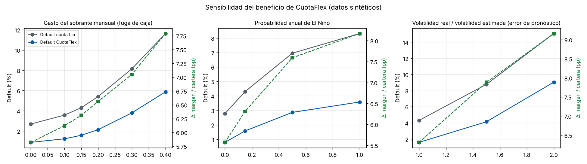

# Análisis de sensibilidad

Cartera sintética de 300 créditos × 100 escenarios. Se varía un supuesto a la vez; el resto queda en `config/parametros.yaml`.

## Gasto del sobrante mensual (fuga de caja)

| Valor | Default fija | Default CuotaFlex | Atraso>30 fija | Atraso>30 CuotaFlex | Δ margen (pp) |
|---|---|---|---|---|---|
| 0.0 | 2.69% | 0.88% | 6.17% | 2.48% | +5.8 |
| 0.1 | 3.57% | 1.23% | 8.34% | 3.42% | +6.1 |
| 0.15 | 4.3% | 1.58% | 10.14% | 4.48% | +6.3 |
| 0.2 | 5.41% | 2.13% | 12.72% | 5.97% | +6.6 |
| 0.3 | 8.14% | 3.79% | 18.77% | 10.22% | +7.1 |
| 0.4 | 11.63% | 5.87% | 25.98% | 15.62% | +7.8 |

## Probabilidad anual de El Niño

| Valor | Default fija | Default CuotaFlex | Atraso>30 fija | Atraso>30 CuotaFlex | Δ margen (pp) |
|---|---|---|---|---|---|
| 0.0 | 2.78% | 0.79% | 8.08% | 3.14% | +5.6 |
| 0.15 | 4.3% | 1.58% | 10.14% | 4.48% | +6.3 |
| 0.5 | 6.95% | 2.86% | 13.49% | 6.74% | +7.6 |
| 1.0 | 8.31% | 3.58% | 15.28% | 7.84% | +8.2 |

## Volatilidad real / volatilidad estimada (error de pronóstico)

| Valor | Default fija | Default CuotaFlex | Atraso>30 fija | Atraso>30 CuotaFlex | Δ margen (pp) |
|---|---|---|---|---|---|
| 1.0 | 4.3% | 1.58% | 10.14% | 4.48% | +6.3 |
| 1.5 | 8.77% | 4.13% | 17.49% | 9.44% | +7.9 |
| 2.0 | 15.07% | 9.04% | 25.75% | 16.9% | +9.2 |
