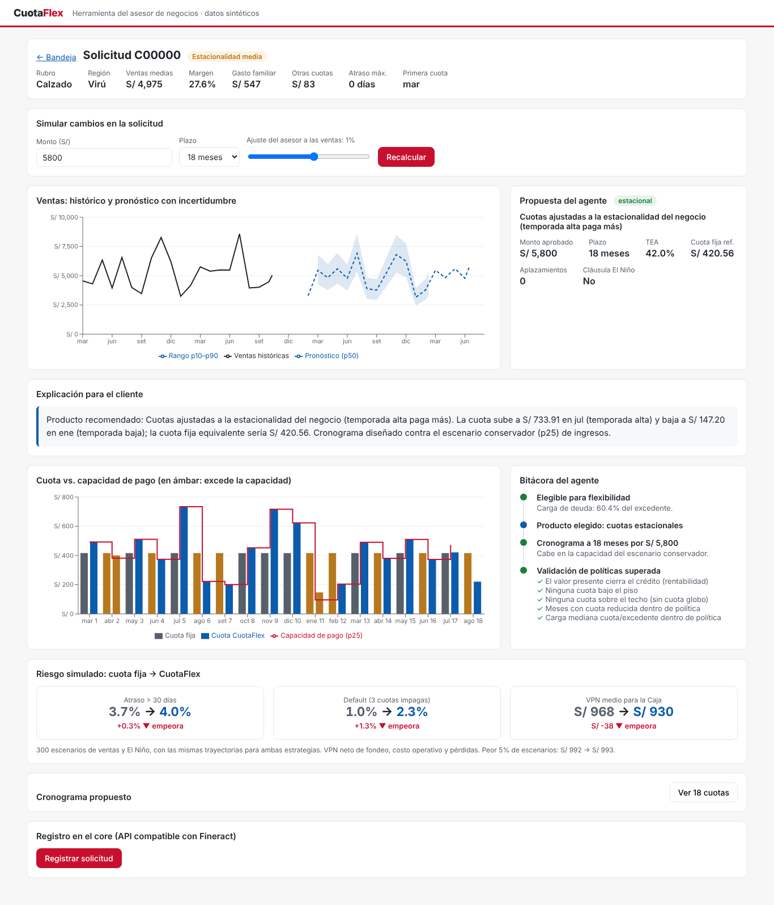
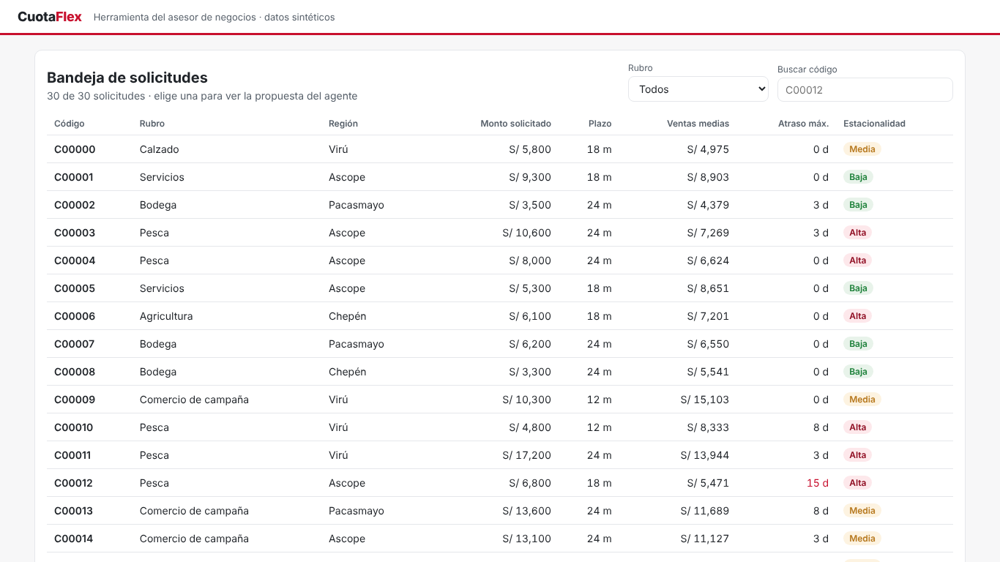

# CuotaFlex · App del asesor (Fase 1 · Lote A)

Herramienta web para el asesor de negocios: bandeja de solicitudes, pronóstico de ventas con
incertidumbre, propuesta del agente (producto, cronograma y explicación), comparación de riesgo con la
cuota fija, bitácora del agente y registro en el core (API compatible con Fineract).

## Cómo correr
```bash
# en la raíz del repo
PYTHONPATH=src uvicorn cuotaflex.api.main:app --reload       # API en :8000
# en web/asesor
npm install
npm run dev                                                   # http://localhost:5173
```
La URL de la API se cambia con `VITE_API_URL` (ver `.env.example`).

## Pantallas
- **Bandeja** (`/`): 30 solicitudes sintéticas, filtro por rubro y búsqueda por código.
- **Ficha** (`/cliente/:id`):
  - ventas históricas y pronóstico p10–p90;
  - propuesta del agente;
  - cuota vs. capacidad de pago (en ámbar, los meses que exceden);
  - bitácora del agente;
  - comparación de riesgo en 300 escenarios;
  - cronograma;
  - cambios de monto, plazo y ajuste del asesor;
  - registro → aprobación → desembolso.

Al registrar, el cronograma que vio el asesor se fija en el core con `addVariations` antes de aprobar,
igual que en Fineract.

## Endpoints usados (`src/cuotaflex/api/routers/asesor.py`)
- `GET /motor/cartera-demo?n=30&semilla=7`
- `POST /motor/propuesta`: propuesta, historial, pronóstico, capacidad y comparación (fija vs. CuotaFlex)
- `POST /fineract-provider/api/v1/clients`, `/loans`, `/loans/{id}/schedule?command=addVariations`, `/loans/{id}?command=approve|disburse`

La propuesta tarda menos de 1 s, simulación de 300 escenarios incluida.

## Capturas


