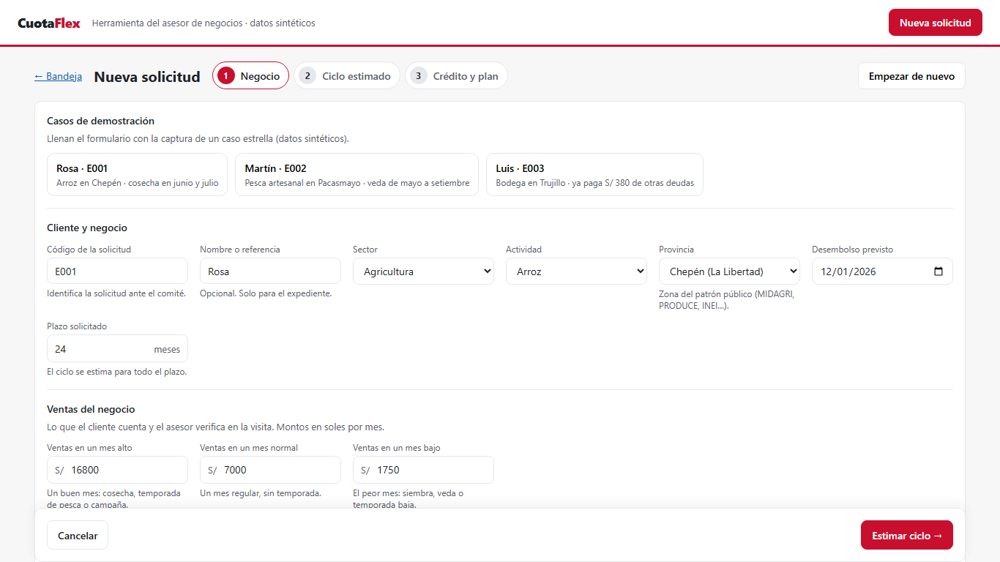
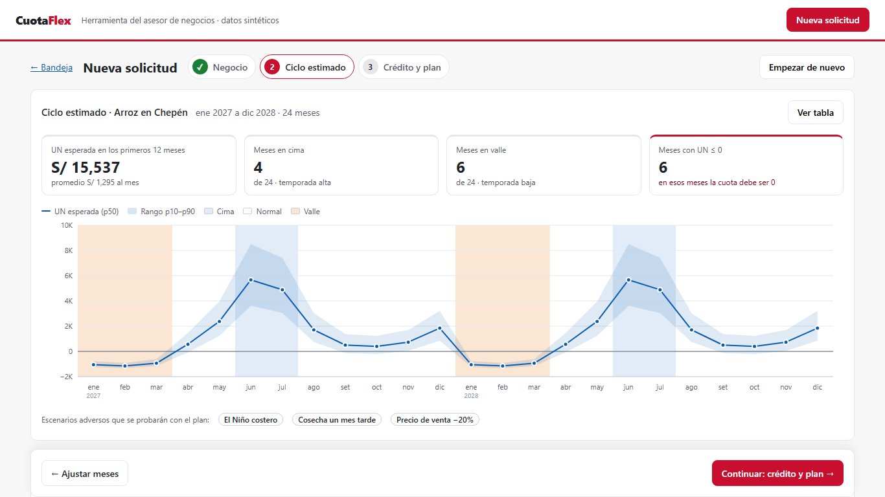
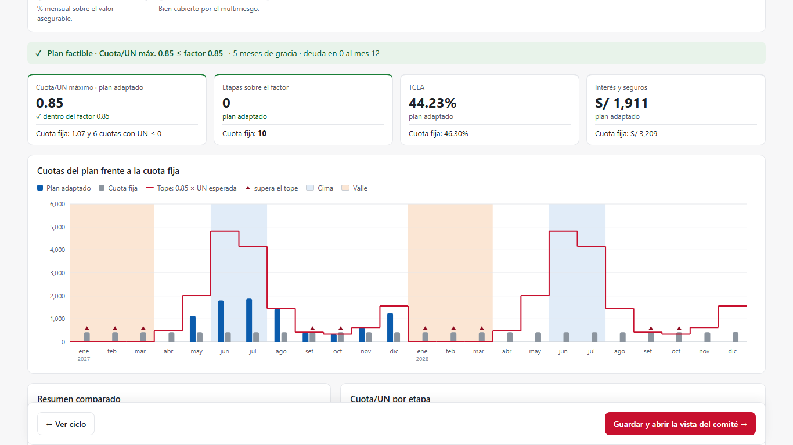
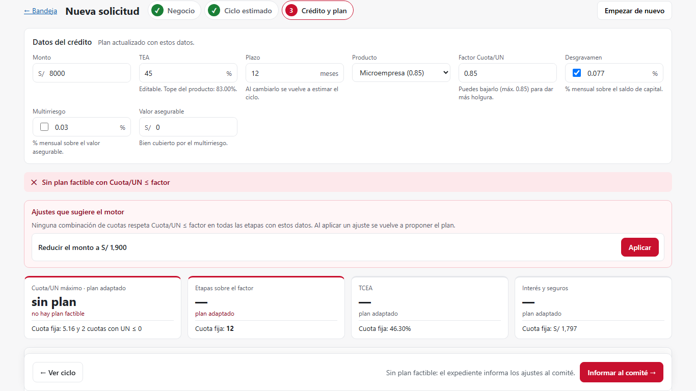
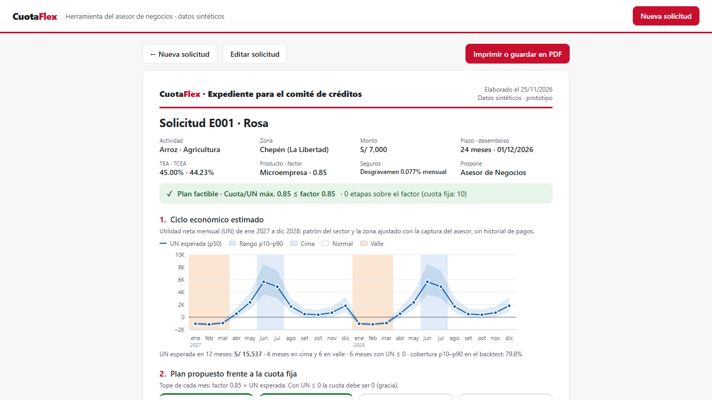

# CuotaFlex · App del asesor

Herramienta web del **Asesor de Negocios**. Desde la fase 4 (FAQ del NEG-01) el flujo principal es la
**nueva solicitud**: el asesor estima el ciclo económico del cliente y, en el mismo lugar, propone un
plan nuevo con cuotas y periodos variables. El **Asesor de Riesgos** valida y el **comité** aprueba en
una vista imprimible. Solo créditos nuevos: el plan queda fijo desde el desembolso.

## Cómo correr
```bash
# en la raíz del repo
PYTHONPATH=src uvicorn cuotaflex.api.main:app --reload       # API en :8000
# en web/asesor
npm install
npm run dev                                                   # http://localhost:5173
```
La URL de la API se cambia con `VITE_API_URL` (ver `.env.example`).

### Modo mock (sin los lotes A y B)
Con `VITE_MOCK=1` el ciclo, el plan y el catálogo salen de los JSON de `src/mocks/`, copia de
`tests/fixtures/contratos/` (caso Rosa). Sirve para trabajar la interfaz sin depender de la API nueva:
```bash
VITE_MOCK=1 npm run dev                      # PowerShell: $env:VITE_MOCK="1"; npm run dev
```
En modo mock el plan es el del contrato aunque cambies la captura. Por encima de S/ 7,000 (y con plazo
menor que 30 meses) responde «no factible» con dos ajustes sugeridos, para probar ese camino.

## Pantallas
- **Nueva solicitud** (`/nueva`), asistente de 3 pasos:
  1. **Negocio:** sector, actividad y provincia del catálogo (`GET /ciclo/catalogo`), desembolso,
     plazo y la captura del asesor: ventas en mes alto, normal y bajo; qué meses son altos o bajos;
     costo de ventas, gastos operativos y tributarios, carga familiar, otras deudas y evidencias
     (Yape o boletas). Validaciones y ayudas en lenguaje de campo, y la utilidad neta que queda en
     cada tipo de mes. Tres casos de demostración (Rosa, Martín y Luis) llenan el formulario.
  2. **Ciclo estimado** (`POST /ciclo/estimar`): UN esperada (p50) con su banda p10–p90 y las etapas
     cima, normal y valle sombreadas; supuestos, fuentes y cobertura del backtest desplegables;
     «Ajustar meses» vuelve al paso 1.
  3. **Crédito y plan** (`POST /plan/proponer` en cada cambio): monto, TEA editable con aviso de
     tope, plazo (vuelve a estimar el ciclo), producto (factor 0.65 o 0.85, editable a la baja) y
     seguros de desgravamen y multirriesgo. Muestra el plan adaptado frente a la cuota fija sobre el
     tope factor × UN, el resumen comparado (total, interés, seguros, TCEA, gracia y etapas sobre el
     factor), Cuota/UN por etapa, el estrés por escenario y el cronograma por periodo con semáforo de
     Cuota/UN. Si no hay plan factible, cada ajuste sugerido tiene su botón «Aplicar».
- **Vista del comité** (`/comite/:id`): expediente limpio e imprimible (A4 vertical, 3 páginas) con el
  ciclo, el plan, el máximo Cuota/UN frente al factor, Cuota/UN por etapa, el estrés, el cronograma,
  los costos, los supuestos y las fuentes, la explicación del agente (o su espacio reservado) y la
  **validación del Asesor de Riesgos** (aprobar, observar con comentario o rechazar), que se guarda en
  este navegador y se imprime con la fecha. `/comite/E001`, `E002` y `E003` se calculan al abrirlos
  si el expediente no está guardado.
- **Bandeja** (`/`) y **ficha** (`/cliente/:id`) de las fases 1 a 3 siguen funcionando. Los
  aplazamientos durante el crédito y el alivio de El Niño en vivo se ocultan con el aviso «fuera del
  alcance del reto (créditos vigentes = reprogramación)»; El Niño se evalúa como escenario adverso al
  diseñar el plan.

## Archivos de la fase 4 (lote C)
- `src/pages/NuevaSolicitud.tsx`, `src/pages/Comite.tsx` y `src/components/plan/**`
- `src/contratos.ts`: tipos de `docs/fases/fase-4/CONTRATOS.md`
- `src/apiPlan.ts`: llamadas nuevas y modo mock; `src/mocks/**`: JSON de ejemplo
- `tests/e2e/test_fase4_c.py`: recorridos en Chromium (modo mock y, cuando la API los tenga, contra
  `/ciclo/estimar` y `/plan/proponer`)
- `docs/demo/comite/`: PDF del comité de los 3 casos estrella y `exportar.py` para regenerarlos

## Endpoints usados
- Fase 4: `GET /ciclo/catalogo`, `POST /ciclo/estimar` (lote B), `POST /plan/proponer` (lote A) y,
  si la API lo publica, `/agente/explicacion-comite` (lote D)
- Fases 1 a 3: `GET /motor/cartera-demo`, `POST /motor/propuesta` y la API compatible con Fineract

## Capturas
**Paso 1 · Negocio** (caso Rosa)


**Paso 2 · Ciclo estimado**


**Paso 3 · Crédito y plan**


**Paso 3 · Sin plan factible** (caso Luis, con el ajuste sugerido)


**Vista del comité**


Fases 1 a 3: [ficha](docs/ficha.png) · [bandeja](docs/bandeja.png)
