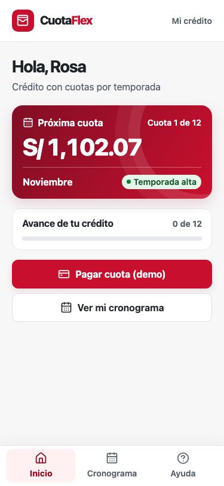
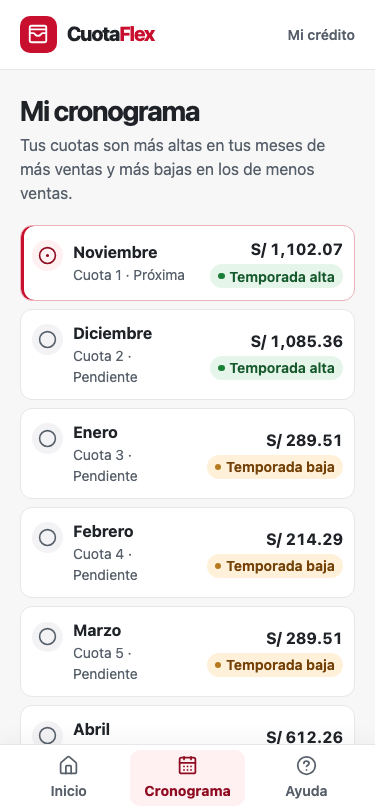
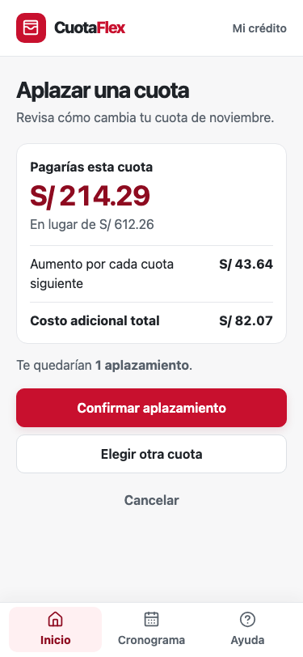

# CuotaFlex · App del cliente

App móvil de la fase 1, lote B. Permite consultar las cuotas de un crédito de demo, registrar pagos, revisar el costo de un aplazamiento y usar el alivio por El Niño.

## Ejecutar en local

Arranca la API desde la raíz del repositorio, con el entorno de Python activado.

```bash
PYTHONPATH=src uvicorn cuotaflex.api.main:app --reload
```

En otra terminal, instala y arranca la app.

```bash
cd web/cliente
npm ci
npm run dev
```

Abre [el panel de demo](http://localhost:5174/?demo=1). Elige **Estacional** para probar el cronograma por temporadas y el alivio. Elige **Con aplazamientos** para ver y confirmar el costo de aplazar una cuota. El interruptor **Alerta El Niño** cambia la alerta global de la demo.

Puedes abrir un crédito registrado por el asesor con `http://localhost:5174/?loanId=ID`, sustituyendo `ID` por el número que muestra la app del asesor. El navegador recuerda el último crédito cargado.

La API usa `http://127.0.0.1:8000` por defecto. Para cambiarla, copia `.env.example` a `.env.local` y ajusta `VITE_API_URL`. Ejecuta `npm run build` para comprobar los tipos y generar `dist/`.

## Capturas a 375 × 812

| Inicio | Cronograma | Vista previa del aplazamiento |
| --- | --- | --- |
|  |  |  |
