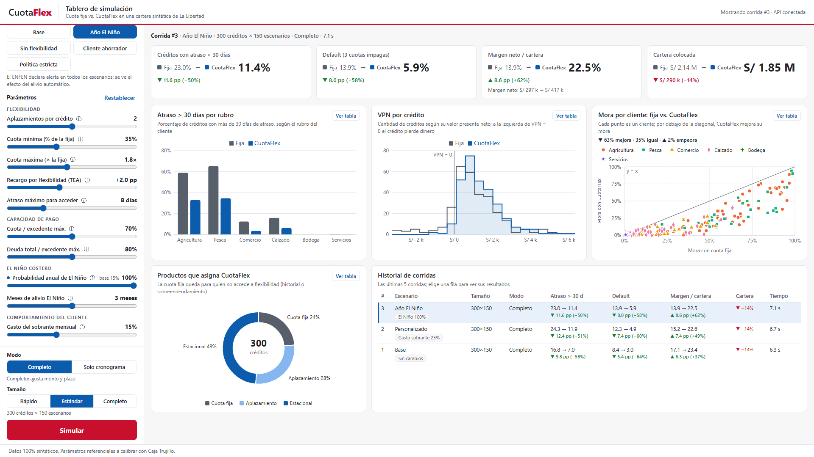
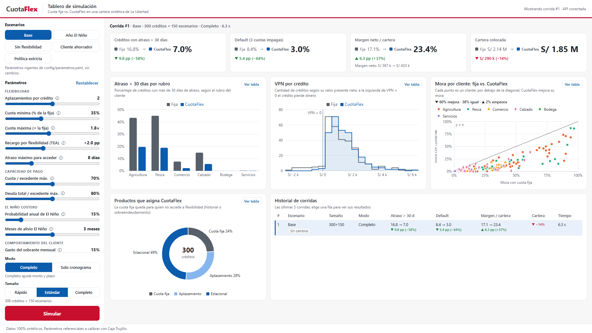
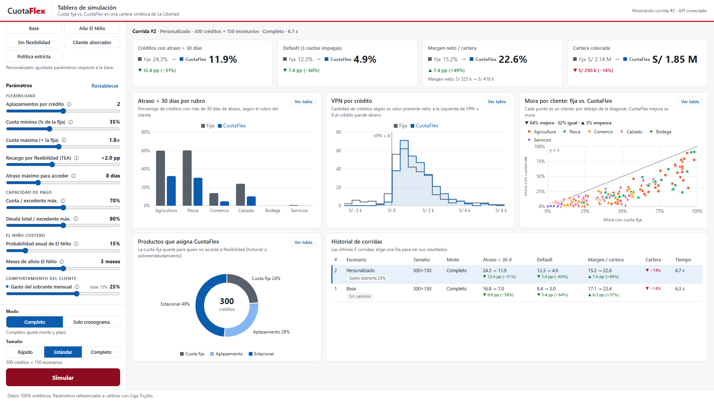
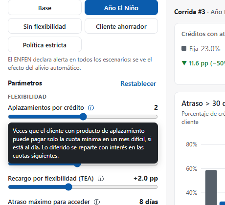
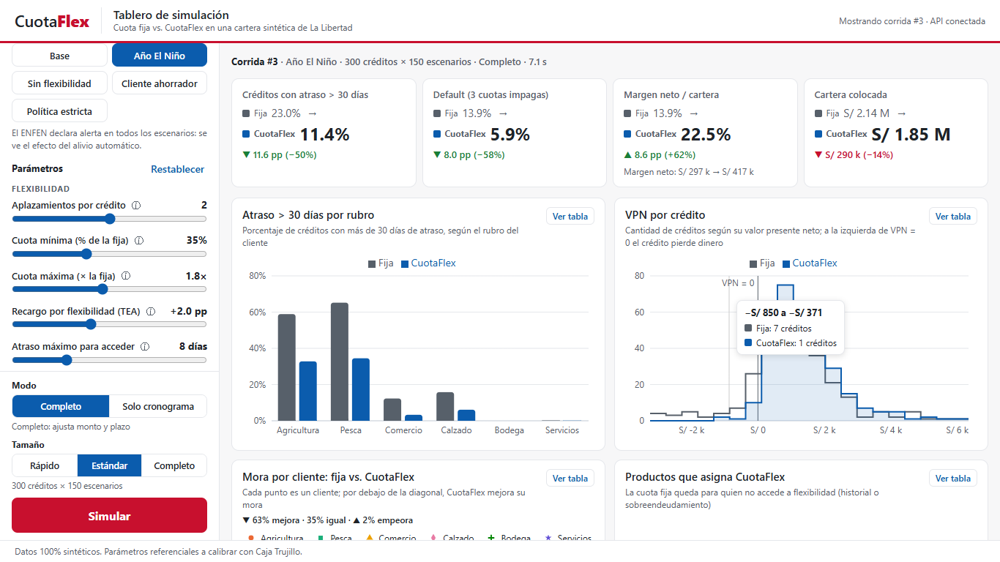

# CuotaFlex · Tablero de simulación en vivo (Fase 1 · Lote C)

Tablero para el jurado: se cambian las políticas (aplazamientos, cuota mínima, recargo, capacidad de
pago, El Niño), se corre la simulación de la cartera sintética y en segundos se ve cómo cambian la mora,
el default y la rentabilidad entre la **cuota fija** (gris) y **CuotaFlex** (azul).



## Cómo correr
```bash
# en la raíz del repo
PYTHONPATH=src uvicorn cuotaflex.api.main:app --reload   # API en http://127.0.0.1:8000
# en web/tablero
npm install
npm run dev                                              # http://localhost:5175
```
En Windows (PowerShell) la API también arranca con `uvicorn --app-dir src cuotaflex.api.main:app --reload`.
La URL de la API se cambia con `VITE_API_URL` (ver `.env.example`). `npm run build` deja el sitio en `dist/`.

## Pantalla
- **Panel izquierdo**
  - Escenarios predefinidos: aplican sus valores y simulan con un clic.
  - Deslizadores generados desde `GET /simulacion/parametros-editables`, con el valor visible, la ayuda
    en un tooltip (ⓘ, también con teclado) y el valor base cuando se cambió.
  - Modo *Completo / Solo cronograma* (`replanificar`) y tamaño *Rápido* (150×80), *Estándar* (300×150)
    o *Completo* (600×200).
  - Botón **Simular** con barra de progreso estimada; mientras corre, los controles quedan desactivados.
- **Indicadores**: atraso > 30 días, default, margen neto / cartera y cartera colocada, cada uno
  fija → CuotaFlex con la diferencia en verde (mejora) o rojo (empeora). En mora y default, bajar es verde.
- **Gráficos** (cada uno con *Ver tabla* para leer los números exactos):
  1. Atraso > 30 días por rubro, barras agrupadas fija vs. CuotaFlex.
  2. Histograma superpuesto del VPN por crédito (20 tramos comunes).
  3. Dispersión de la mora de cada cliente con cuota fija (X) y con CuotaFlex (Y), con la diagonal y = x:
     debajo de la diagonal, CuotaFlex mejora. Color y forma por rubro; clic en la leyenda para aislar uno.
  4. Dona con los productos que asigna CuotaFlex (fija, aplazamiento, estacional).
- **Historial de corridas**: las últimas 5 con los parámetros cambiados y los indicadores clave; clic en
  una fila para volver a ver esa corrida.
- **Pie fijo**: "Datos 100% sintéticos. Parámetros referenciales a calibrar con Caja Trujillo."
- Si la simulación falla o tarda más de 30 s, aparece un aviso y los controles se reactivan.

Pensado para proyectarse en 1920×1080 (todo cabe en una pantalla) y usable en 1366×768 (dos columnas
con desplazamiento).

## Endpoints (`src/cuotaflex/api/routers/simulacion.py`)
- `GET /simulacion/parametros-editables`: las 10 rutas editables con etiqueta, rango, paso, formato,
  ayuda y valor actual.
- `GET /simulacion/escenarios`: Base, Año El Niño, Sin flexibilidad (control), Cliente ahorrador y
  Política estricta.
- `POST /simulacion/correr`
  ```json
  {"n_clientes": 200, "n_escenarios": 100, "semilla": 2026, "replanificar": true,
   "cambios": {"flexibilidad.max_aplazamientos": 3, "el_nino.probabilidad_anual": 1.0}}
  ```
  - Responde 422 si `n_clientes > 600`, `n_escenarios > 300`, una ruta no es editable o un valor sale de
    su rango válido.
  - Aplica los cambios sobre una copia profunda de `cargar_parametros()`, así que la configuración global
    no se altera.
  - Devuelve `resumen`, `histograma_vpn`, `dispersion`, `duracion_s`, `parametros_usados`, `consulta`,
    `desde_cache` y `rendimiento`.
  - Guarda en caché hasta 50 corridas por el hash del cuerpo normalizado: la misma consulta responde al instante.

## Rendimiento
Tiempos de `POST /simulacion/correr` con el escenario Base y la semilla 2026, en una laptop con Intel Core
i5-13420H (12 hilos), 16 GB de RAM, Windows 11 y Python 3.12. *Primera corrida* es sin caché y con los
procesos ya iniciados (el tablero los inicia al cargar).

| Tamaño | Créditos × escenarios | Modo | Primera corrida | Repetida (caché) | Sin paralelo (referencia) |
|---|---|---|---|---|---|
| Rápido | 150 × 80 | Completo | 3.8 s | 0.01 s | 7.3 s |
| Rápido | 150 × 80 | Solo cronograma | 1.8 s | 0.01 s | 2.2 s |
| Meta del lote (< 10 s) | 200 × 100 | Completo | **3.9 s** | 0.01 s | 12.7 s |
| Meta del lote (< 10 s) | 200 × 100 | Solo cronograma | 1.9 s | 0.01 s | 4.6 s |
| Estándar | 300 × 150 | Completo | 5.5 s | 0.01 s | 19.2 s |
| Estándar | 300 × 150 | Solo cronograma | 3.2 s | 0.01 s | 7.6 s |
| Completo | 600 × 200 | Completo | 11.0 s | 0.02 s | 36.5 s |
| Completo | 600 × 200 | Solo cronograma | 4.7 s | 0.01 s | 13.9 s |

En el tablero, con el navegador abierto, el escenario Base en tamaño Estándar tardó 6.3 s en la sesión de
las capturas. Cada respuesta trae `duracion_s` y `rendimiento`, así que se puede medir de nuevo con:
```bash
curl -s -X POST http://127.0.0.1:8000/simulacion/correr -H "Content-Type: application/json" \
  -d '{"n_clientes": 200, "n_escenarios": 100, "semilla": 31}' \
  | python -c "import json, sys; d = json.load(sys.stdin); print(d['duracion_s'], d['rendimiento'])"
```

**Por qué en paralelo.** Casi todo el tiempo del motor se va en los cronogramas óptimos (MILP con CVXPY y
HiGHS) que el agente resuelve uno por uno: unos 30 ms cada uno, y más de 300 por cada 200 créditos en modo
Completo, porque al replanificar prueba varios plazos y montos. En secuencia, 200 × 100 tardaba 12.7 s
(la meta es menos de 10 s) y 600 × 200 pasaba los 30 s que espera el tablero. Por eso el router reparte esos
cronogramas entre procesos y después llama a `comparar_cartera` en un proceso que los toma de memoria.
- El resultado es idéntico al secuencial: la memoria se indexa por las entradas exactas del optimizador y,
  si falta alguna, se calcula. Lo comprueba `test_paralelo_da_exactamente_el_resultado_secuencial`.
- No se modifica el motor ni el proceso de la API: el envoltorio con memoria solo existe en los procesos trabajadores.
- `CUOTAFLEX_SIM_PROCESOS` fija el número de procesos. Por defecto son los núcleos menos 2, con un máximo
  de 10; con 0 o 1 todo corre en secuencia. Con menos de 50 créditos siempre se calcula en secuencia.
- Los trabajadores arrancan con BLAS de un hilo (`OPENBLAS_NUM_THREADS=1`). Así cada uno reserva unos 130 MB
  en lugar de 2,2 GB en Windows, porque OpenBLAS reserva búferes por hilo al importar numpy y scipy.
- Si algo falla (falta de memoria, un proceso caído), la corrida se repite en secuencia y el modo paralelo se
  pausa 10 minutos.

## Pruebas
`pytest tests/test_lote_c_simulacion.py` cubre:
- las 10 rutas editables y los escenarios;
- la respuesta de `correr`, con el histograma de 20 tramos;
- los 422 por ruta, rango, entero o tamaño;
- que la configuración global no se altere;
- la caché (la segunda llamada idéntica y el tope de 50);
- paralelo = secuencial;
- que en un año El Niño CuotaFlex baje el default frente a la cuota fija.

## Capturas
Escenario Base en tamaño Estándar (1920×1080):


Se sube el gasto del sobrante al 25% y se vuelve a simular. Cambian los indicadores y el historial guarda las dos corridas:


Ayuda de cada parámetro y la vista en 1366×768:

 

## Notas de diseño
- Colores fijos por estrategia: fija en gris (`--cf-gris-600`) y CuotaFlex en azul (`--cf-azul`).
  Como gris y azul se parecen para algunas personas, cada gráfico con las dos estrategias lleva leyenda,
  y los tooltips y las tablas nombran la estrategia.
- En la dispersión, seis colores no se distinguen bien entre sí, así que cada rubro también tiene su forma.
  La leyenda permite aislar un rubro.
- Mientras corre una simulación, los resultados anteriores quedan atenuados en vez de desaparecer.
- Datos 100% sintéticos; ningún dato real de clientes.
